# Changelog

Every merge to main that carries a release note becomes a version. The newest is first.
The app shows these notes, with their pictures, on Home when a newer version is out.
How notes are written: docs/RELEASING.md.

## 0.31.0 (2026-11-25)

### New

#### The table opens with a slow zoom-in (#446)

When the table starts, the map at rest begins zoomed out over the city around it, holds a moment, then slowly and smoothly zooms in to the table, as the Lindholmen table did. Reset on the controller plays it again; switching layers does not.

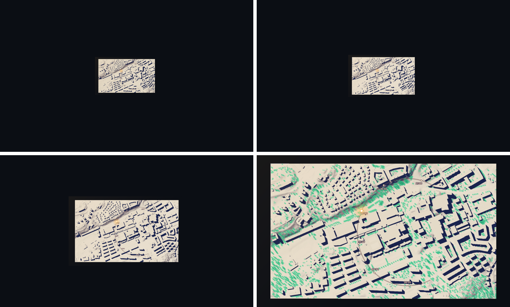

## 0.30.1 (2026-11-25)

### Fixes

#### Command search shows its results on the Mac (#441)

Cmd+K command search keeps a steady height, so its list of results shows on the Mac too. Before, WebKit squashed it to one cut-off row between the field and the footer.

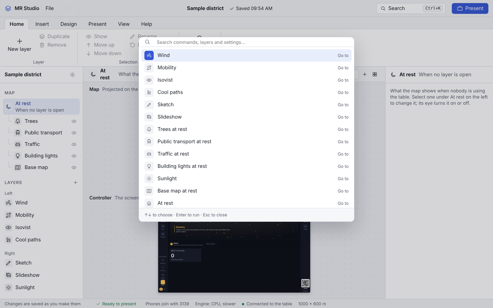

## 0.30.0 (2026-11-25)

### New

#### The editor is laid out like PowerPoint again (#392, #382, #383, #385)

The ribbon has PowerPoint's tabs: **Home** for what is selected, **Insert** for layers, data, pictures, video, sound and 3D models, **Design** for the controller's theme and button style, **Present** for Ready to present?, Rehearse, Present and Share, **View** and **Help**. Opening a tab changes the ribbon only: what is selected and what the map shows stay as they were. Every tab fits a 13-inch laptop.

Settings of the whole table are dialogs, as Slide Size is: **Design, Table size and place…** (name, place, size, time zone, where visitors stand) and **Welcome and languages…**. This computer's screens, calibration, colour and quality are in **Present, Screens and calibration…**, and every file of the table in **View, Media library…**. Map life sits under **At rest** in the list, each with an eye to turn it on or off. The setup guide now only starts a new table.

Behind it, every command and setting is declared once and the tabs are a layout file, so moving a command is a one-line change and a test checks that each setting has one home.

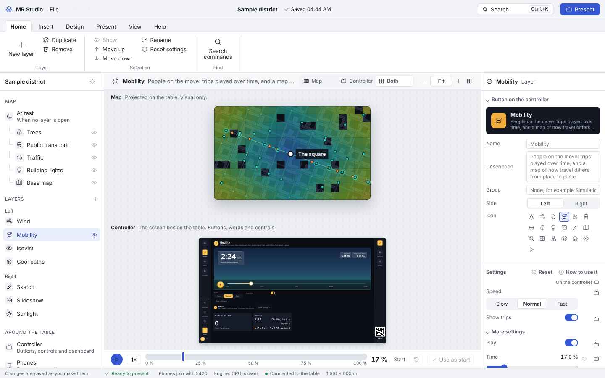

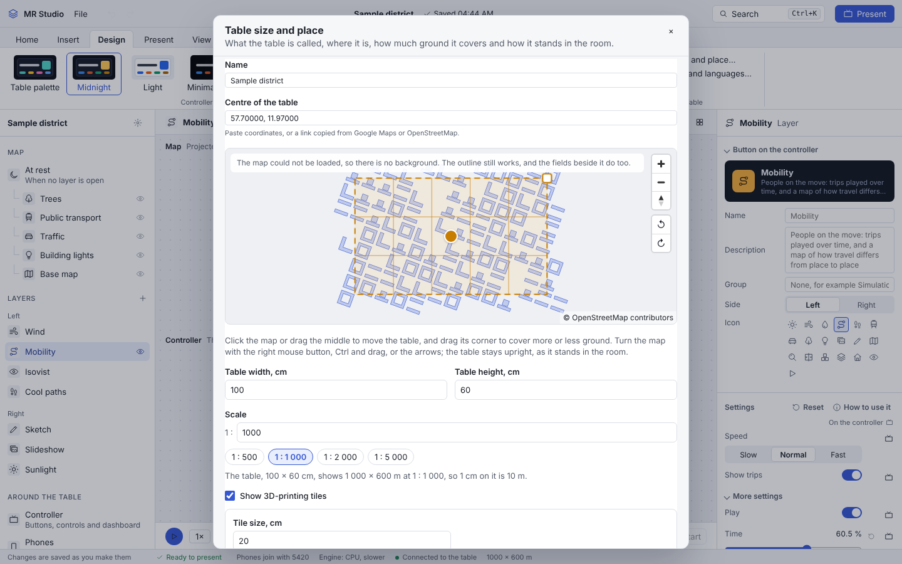

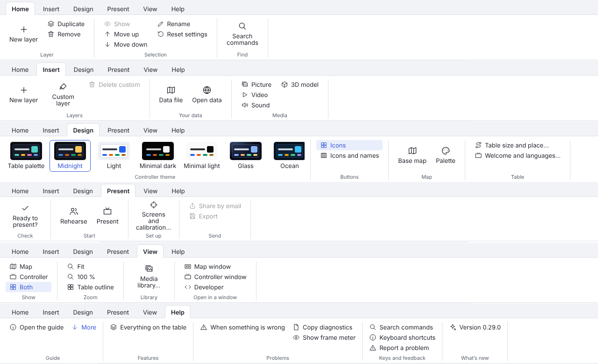

## 0.29.1 (2026-11-25)

### Fixes

#### Open data that arrives, layers that line up, phones that stay (#424, #411, #414, #422)

**OpenStreetMap no longer hangs.** The second mirror was the same silent server as the third, and each try waited 200 s. Now each server is asked once, a server that has not started answering in 20 s is skipped, and a table wider than 1.2 km is asked in tiles, so the main server stops refusing buildings. The Fetch everything dialog says which server and part it is on, and when no server answers it says so within about a minute.

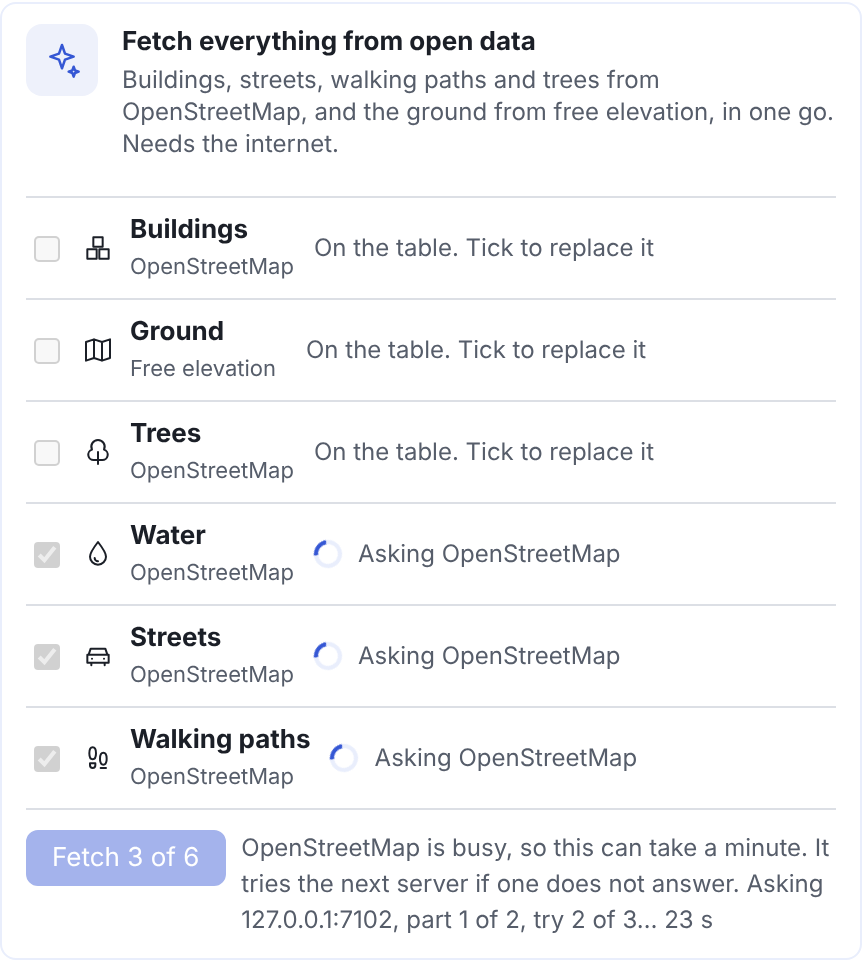

**Buildings keep their heights** when a file mixes height names, for example `height` on most and `höjd` on some. The import notes how many came from another name.

**Custom layers line up with the map** (layer builder layers, place motions, blocks). They were drawn about 12 % too large when the table sat inside margins, and spilled past its edge. Before and after:

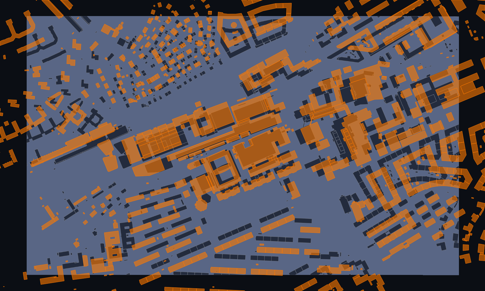
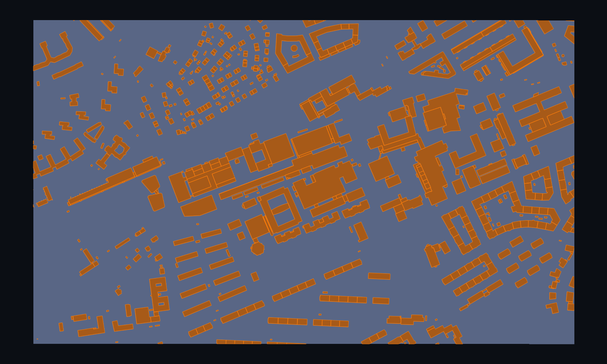

**Phones stay joined when the controller window goes.** Every window that carries phones now uses the same phone link, so when the controller closes, sleeps, or is hidden, the table takes over in a few seconds and phones come back on their own, without scanning again.

## 0.29.0 (2026-11-24)

### New

#### A frame meter shows what each layer costs (#262)

Press Ctrl+Shift+P on the table or controller, or choose Help › Show frame meter in the editor, to see frames per second, the worst frame of the last 10 seconds and how many milliseconds each layer takes per frame. When the table falls below 54 frames a second, the editor's status bar says so and its tooltip names the costliest layer and what to try. Diagnostics list each window's worst frame and costliest layers.

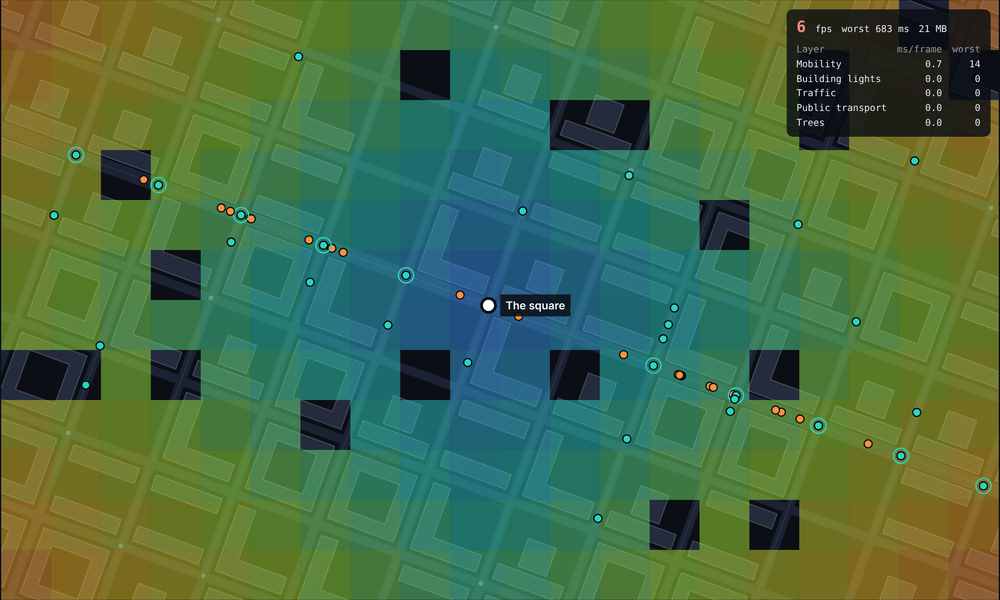

## 0.28.0 (2026-11-24)

### New

#### The editor says what it is doing, and when it lost the table (#68)

If the table stops answering, the editor says "Lost connection to the table. Reconnecting…", greys out what cannot be changed until it is back, and comes back by itself where you were. "Saved" waits for the table to confirm and shows "Saving…" until it has. While a simulation settles or shadows are worked out, the status bar shows the engine at work, with a progress bar, and it names the engine plainly ("CPU, slower" when there is no graphics card). A layer button in the ribbon stays busy until its layer is in, so a second click does not add a second one.

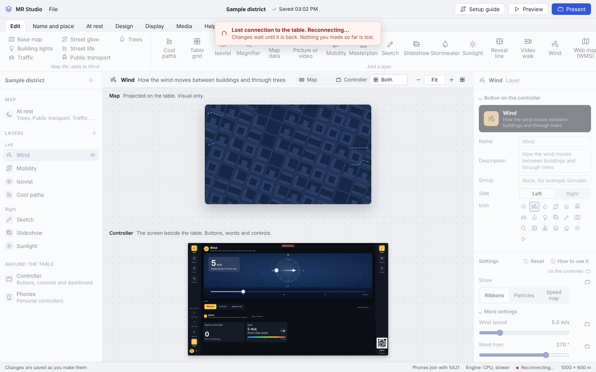
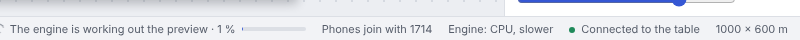

#### See the map on its own, zoomed in, with the table's tiles

A bar above the canvas picks what fills the middle of the editor: the Map, the Controller, or Both. The map can be zoomed: Fit shows the whole table, 100 % shows it at the projector's own pixels, and + and − (or ⌘/Ctrl and the scroll wheel) go further. Hold space and drag, or drag with the middle button, to move around. The grid button draws the table's edge and its tile seams over the map, so you see where they fall.

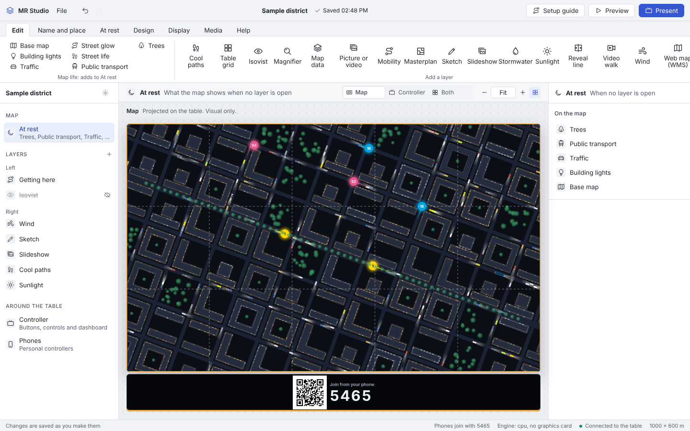
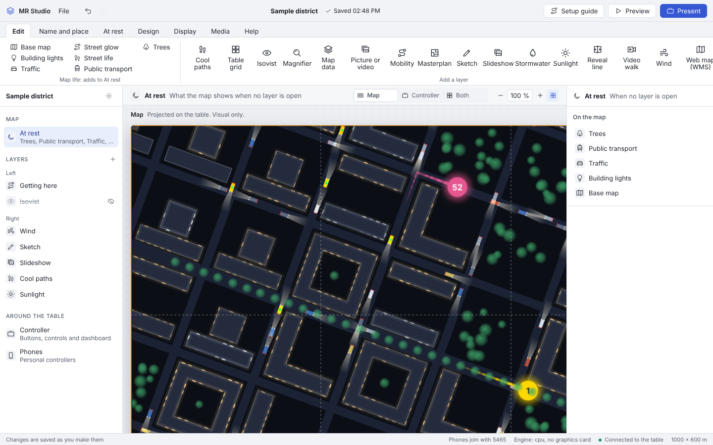

#### Ready to present? One list of what to check (#63)

A Checks button in the status bar counts what is left before the table is ready to show, and opens the whole list grouped as Must fix, Should fix and Nice to have. Each item has a button that goes to where it is fixed: bringing in the streets Traffic needs, the time zone, the projector's calibration, a one-sided controller, buttons all hidden, an empty map at rest. Present asks first when something must or should be fixed, with Present anyway. The blue Next line shows the first thing the table must have. The MCP server checks a table with the same rules, so Claude and the editor name the same problems.

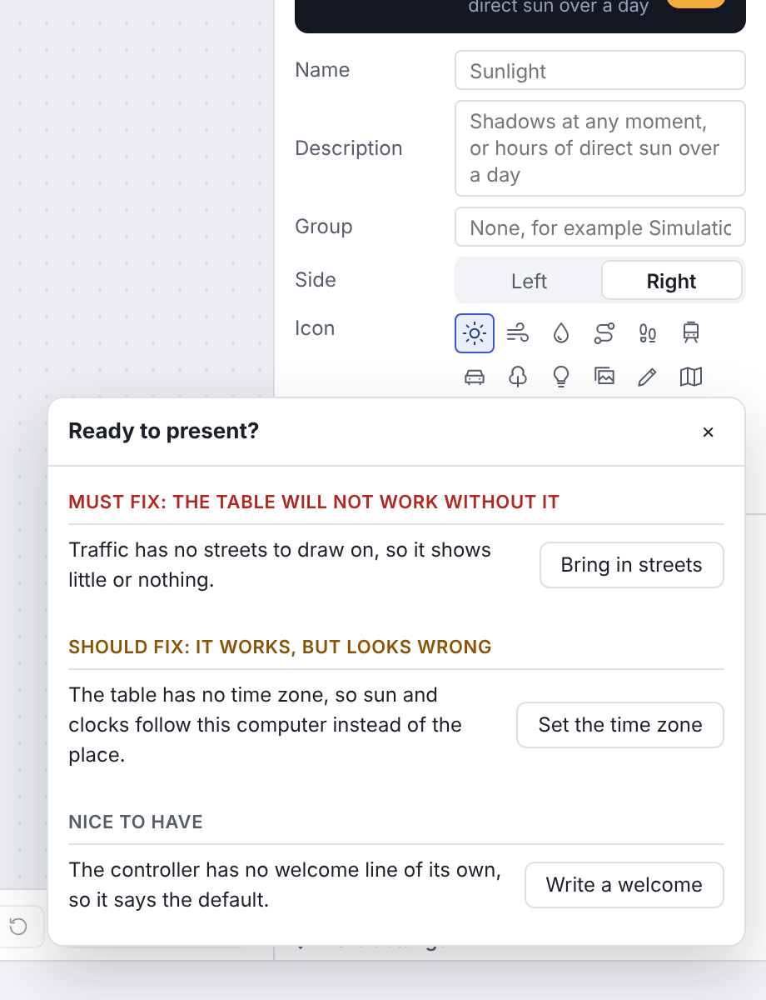
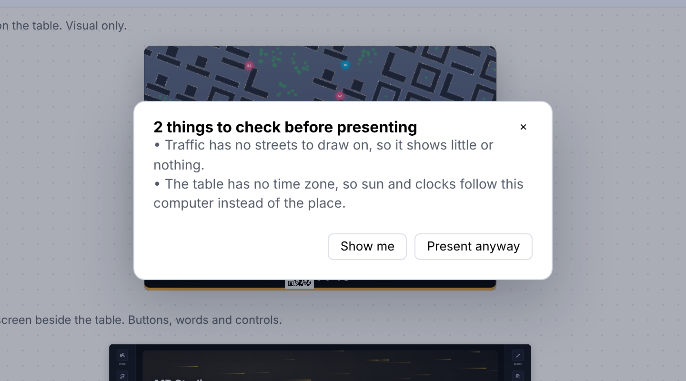

#### Search every command with Cmd/Ctrl+K, and the keys on one sheet (#65)

Press Cmd+K (Ctrl+K on Windows), or the Search box at the top, and type a few words: "wind" goes to the Wind layer, "add sun" adds Sunlight, "zoom 100" shows the map at the projector's own size, "present" starts presenting. Every layer, the places in the list, the ribbon's tools and tabs, the view of the map and the Help pages are there. Cmd/Ctrl+/ shows every keyboard shortcut on one sheet, and Cmd/Ctrl+Enter presents. In the app, the menu bar has View (search, Map, Controller, both, Fit, 100 %, table outline) and Help (the guide, keyboard shortcuts, report a problem).

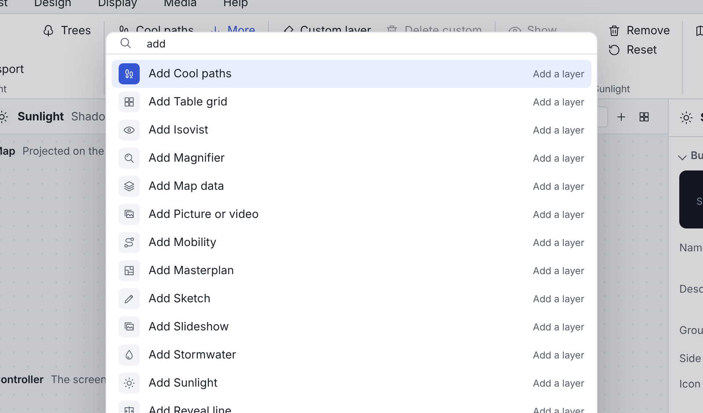
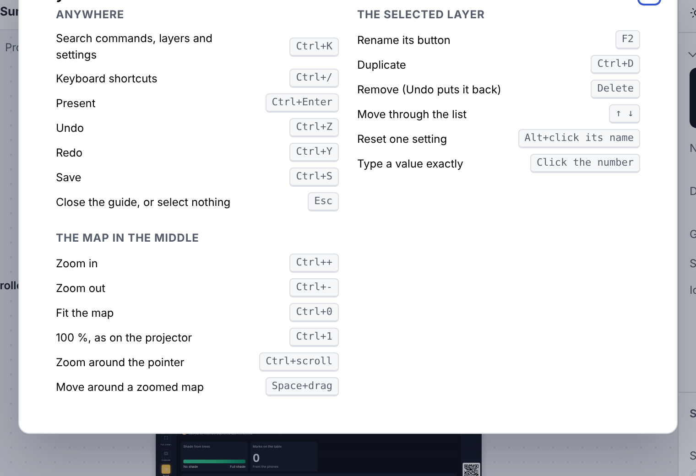

#### Every button says what it does, and Report a problem (#88)

Every button in the editor now shows what it does when the pointer rests on it, the small icon-only ones too, and tooltips name the keyboard shortcut where there is one. The Help tab has Search commands, Keyboard shortcuts and Report a problem, which opens a new GitHub issue with the version, the computer and the table's layers filled in; nothing is sent until you send it.

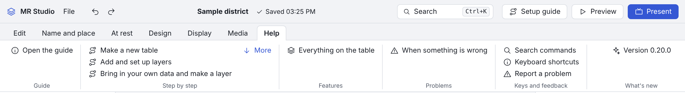

#### Type exact values, reset a setting, and see the button you are making (#64)

In a layer's settings, click a slider's number to type a value: "7,5" for the wind, "13:30" for a time of day. Times now read as a clock (12:00, not 12.00 h) on the controller too. A small arrow beside a changed setting puts it back to the layer's own value (or Alt/Option-click its name), and Reset puts the whole layer back, with Undo. Long layers fold their rarely used settings under More settings, as the controller does. The column that decides what visitors get says "On the controller" once, with its own icon, and every Sunlight, Wind and Traffic setting explains itself when you point at it. The Button section shows the button as visitors will see it while you type, and folds away.

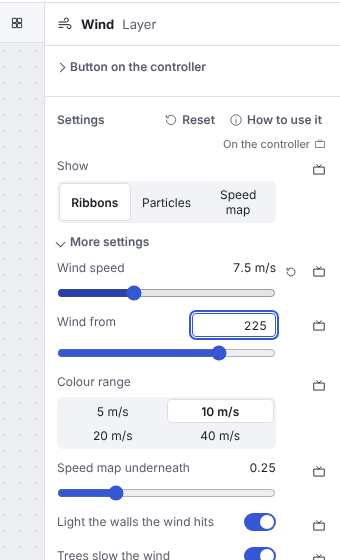
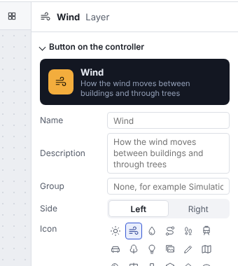

#### Drag layers between the controller's sides, rename them in place (#58)

The editor's list of layers is now the controller's two rails, Left and Right. Drag a layer up or down, or across to the other side, and its button moves on the controller. Double-click a layer (or press F2) to rename its button. Right-click for Open, Rename, Duplicate, Hide from the controller, Move to the other side and Remove. The eye on a row keeps a button off the controller and phones without taking the layer out of the table. Delete removes what is selected, with Undo on the notice, and Ctrl+D (⌘D on a Mac) duplicates it, settings and items included. Back and Forward move between what you were editing.

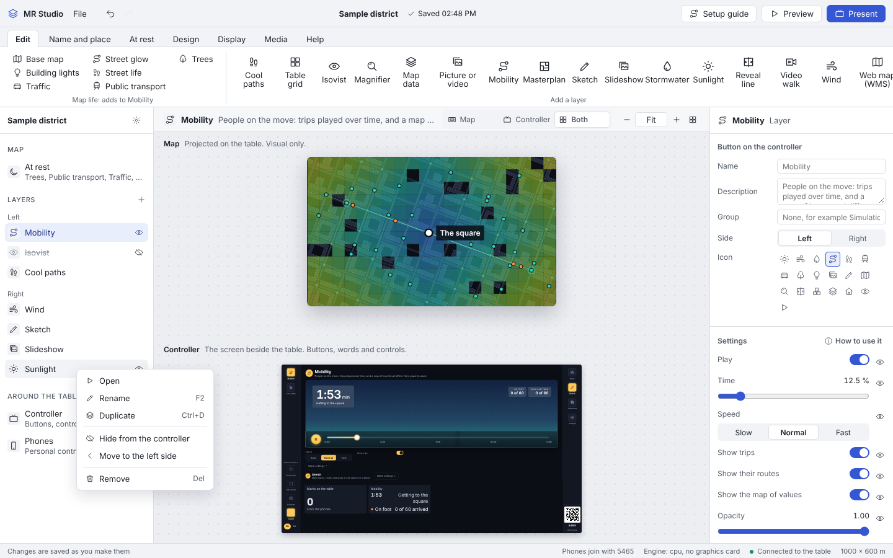
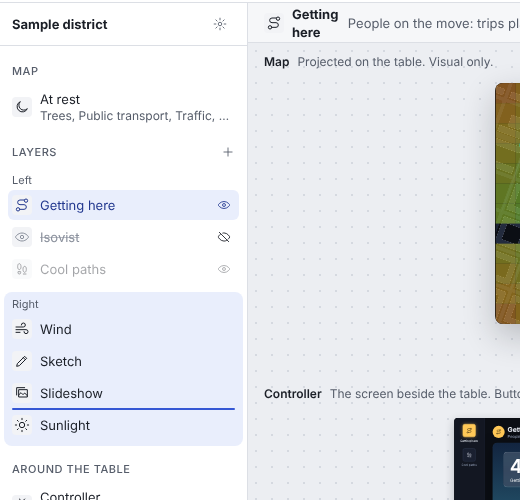

#### Rehearse: try the table as a visitor without the real displays (#97)

Rehearse in the editor's title bar puts the map, a controller and a visitor's phone side by side on one screen. Press the controller and the phone as a visitor would, and the map follows. Nothing is saved and the projector and controller screens are not used. You can make the controller go home after 20 seconds untouched to try the idle reset. Finish (or Escape) puts every layer back as it was, and says how many layers you opened, which you did not try, and what is still to check before presenting.

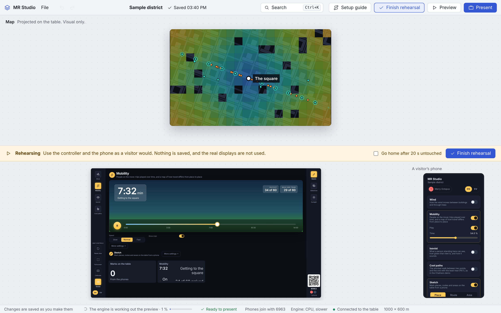
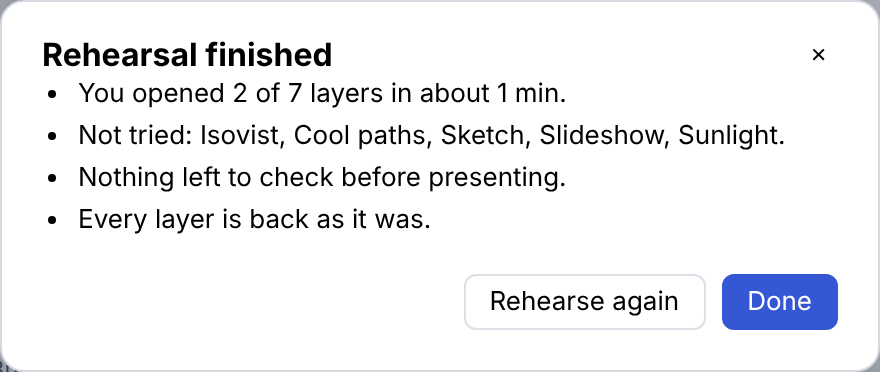

#### The editor fits a 13-inch laptop (#66)

On a smaller screen the ribbon folds its big buttons into columns of small ones, and a long group such as Add a layer keeps its first columns and puts the rest under More, instead of running off the edge. The selected layer's tools always stay in view. Below about 1100 pixels wide the settings become a drawer over the right of the map that opens when you pick something and closes with Escape or a click on the map. The status line stays on one line.

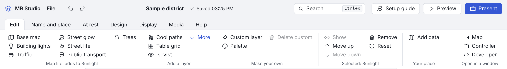
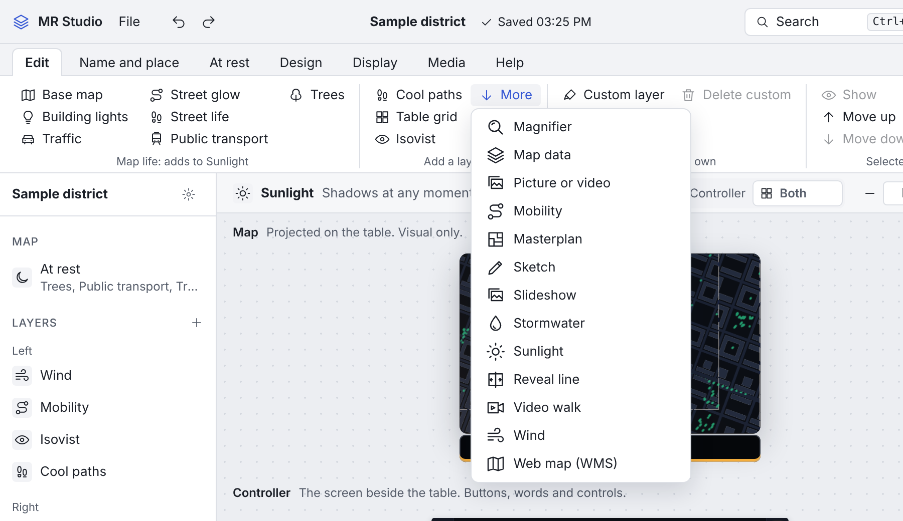
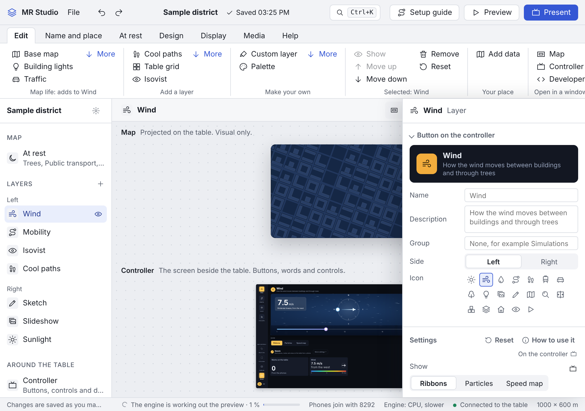

#### Table settings: where visitors stand and the ribbons (#62)

Table settings has a new part, The table itself: its size and tiles, the projector's calibration on this computer, the edge of the picture where visitors stand, and each side's ribbon (default, off, if room, or a width in cm). The projector moves the ribbons at once, without starting again. The controller's look links to the Design tab. With this, everything in a table's file that is not a layer can be changed from the editor.

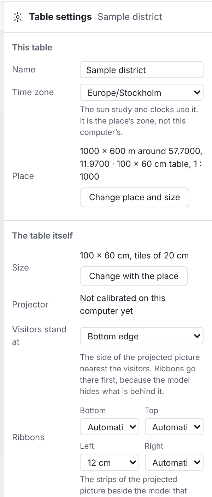

#### Scrub through the day without changing the layer (#61)

Sunlight, Cool paths and Mobility get a time bar under the canvas: drag along the day (night, twilight and day are shaded from the sun at your table), play it at 1×, 4× or 16×, and the map and controller follow. It is a preview only: the layer still starts where it did until you press Use as start. Leaving the layer puts the preview back. Layers name their time controls with `clock` in layer.json.

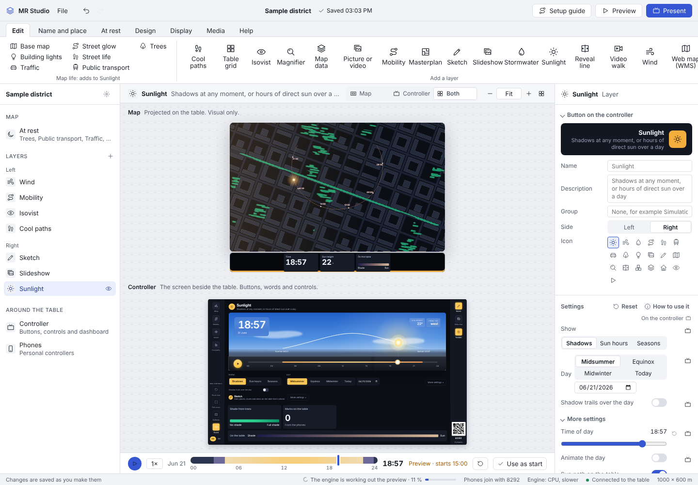

## 0.27.1 (2026-11-24)

### Fixes

#### The MCP server knows golden hour and stages made of panels (#363, #357, #353, #358, #370, #342)

An LLM designing with the MCP server now finds the sun study's golden hour, and it helps a developer build a controller view from panels before writing code: `check_layer` checks a stage made of panels against the same density budget as the TV, makes sure its control and map panels name the layer's real controls and tools, recognises a layer's own widgets, and asks for their titles in Swedish. `preview_layer` points to the Developer workbench in `/dev`, and the code layer and controller app prompts start from panels. Custom layers now say they can be tapped for facts, filtered, given a palette theme and a map of their places on the controller, and the command-line help points to the app's Install command line tool.

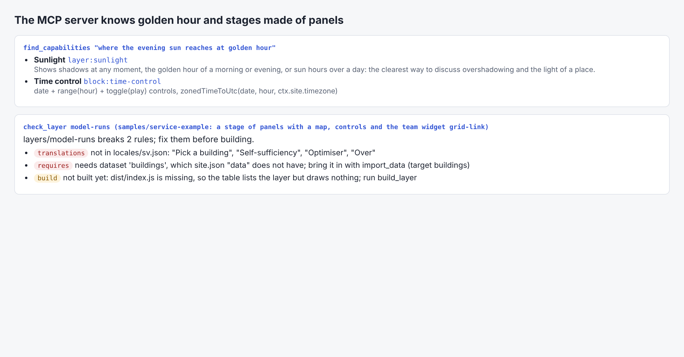

## 0.27.0 (2026-11-24)

### New

#### The campus energy community (ECOM) on the Chalmers table (#192)
The Chalmers table has the energy community from the old interactive map, rebuilt on 2.0's building blocks as a test of how well a code-heavy layer ports. It plays a summer day. Energy flows along the streets from roofs, the grid and the battery, and each building fills by how much of its use the community covers that hour. On the controller you can:

- tap a building to take it out of the community or change the solar on its roof
- watch self-sufficiency and where the power comes from
- compare the day's grid import together against each building on its own

With the ECOM model running, a change asks the model again. Without it, the last exported day is shown. What the port still needs from the SDK is in #373.

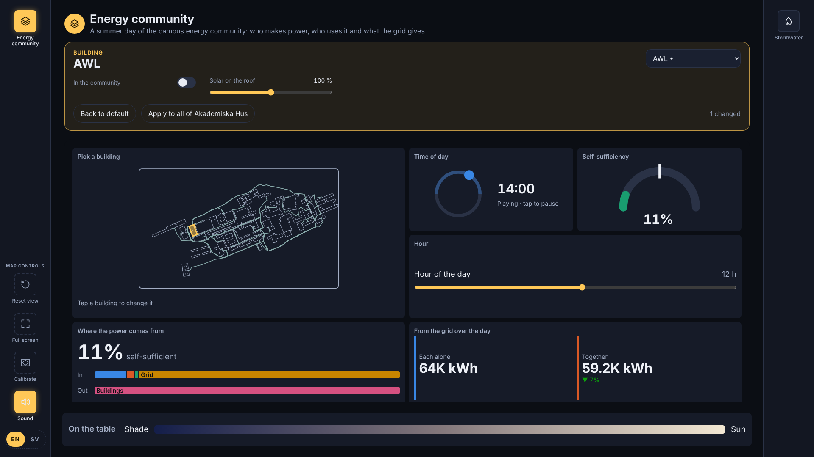

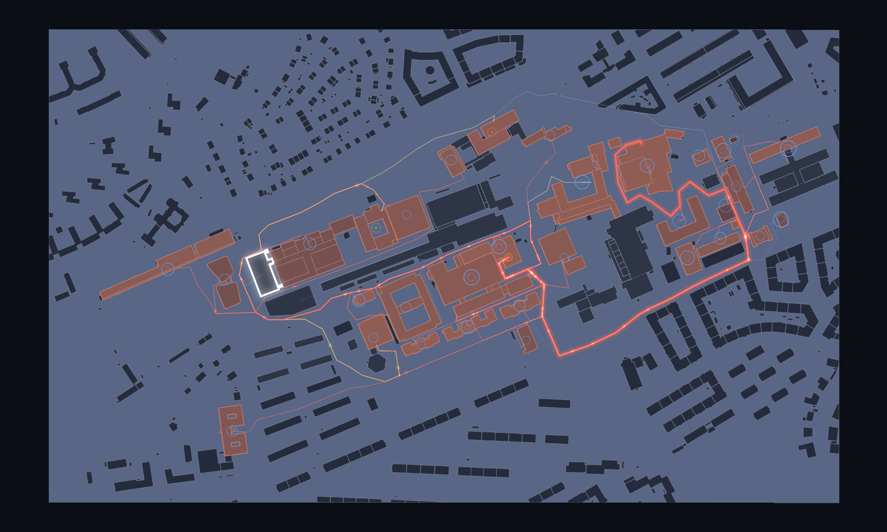

## 0.26.0 (2026-11-24)

### New

#### Place a drawing by hand on the map (#301)

With a Masterplan open in the editor, its frame now sits on the map with handles: drag inside it to move the drawing, a corner to scale it, the round handle to turn it. Letting go saves where it is. **Turn the drawing** shows a drawing that was drawn on its side the right way round, and keeps its shape when you change it.

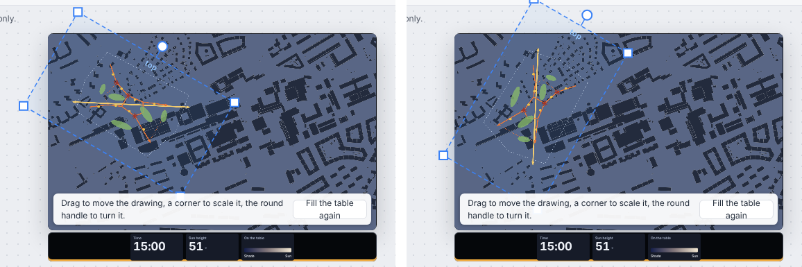

#### Place motions fit a real table, and Next tells their story (#341)

The place motions now follow how far apart your places are. Reach, pull and travel scale with the places' spacing, and dots, lines and glows shrink only a little, so Gravity well no longer floods the map and Pilgrims are small walkers again on a 1 m table. A new **Scale** knob adjusts the fit. Motions that need the buildings (Threads of belonging, Lit blocks, Gravity well) now get them when the controller switches to them, so threads appear.

Turn on **Next shows the places, then starts it** in the builder's Motion tab and a guide can step it like the old Cultural Gravity layer: the first Next brings the places in one by one, the second starts the motion.

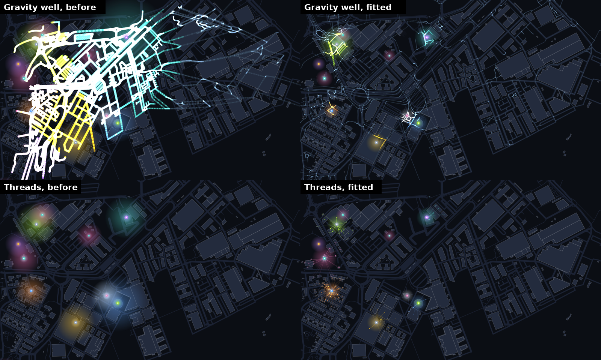

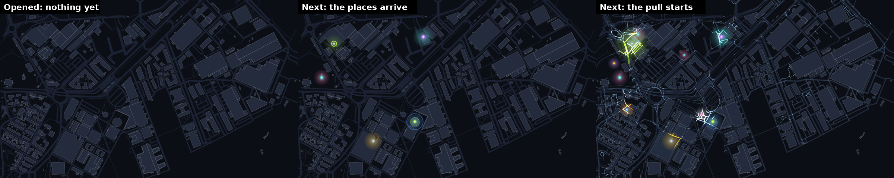

#### Water on the table: rivers stay cool and take the rain (#343)

A table can now say where its water is: a river, a lake, a harbour or the sea. Bring it in with **Add data, Water** (a GeoJSON of areas, or straight from OpenStreetMap), or point `scene.water` at a GeoTIFF mask. Thermal comfort shows the water as cool instead of hot ground, Stormwater lets the runoff drain into it, and the dark base map draws it. On the Lindholmen table, Göta älv now reads as water.

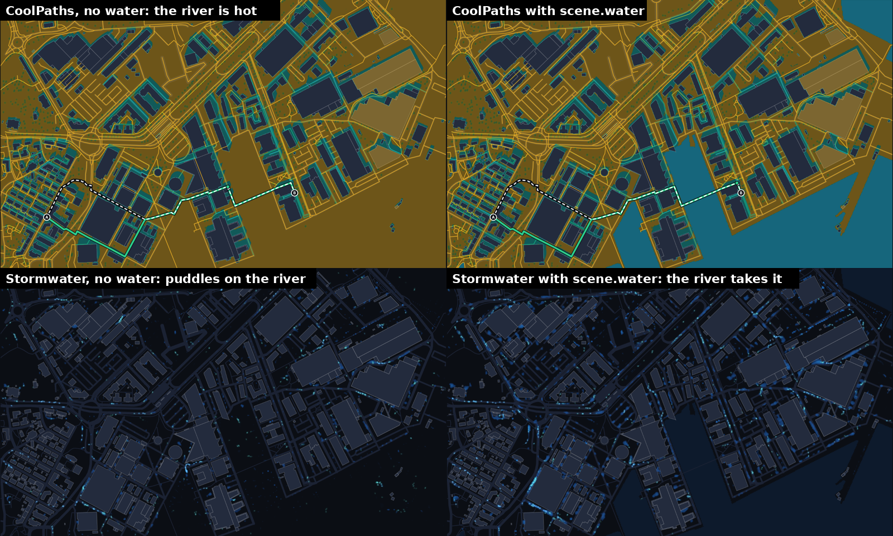

#### Models in map coordinates and surface-model terrain come in through Add data (#344)

A 3D model exported in SWEREF 99 TM (or a SWEREF 99 local zone, or UTM) metres is now placed where it belongs as it comes in: no anchor, units or turn to work out. A terrain GeoTIFF that has the buildings raised in it (a surface model) is noticed, and **Take the buildings out of the ground** keeps only the ground under them, so the buildings stop counting as hills. Both Lindholmen files now come in with no script: the model lands where the hand-placed one did, and the built area is 24 % of the table again.

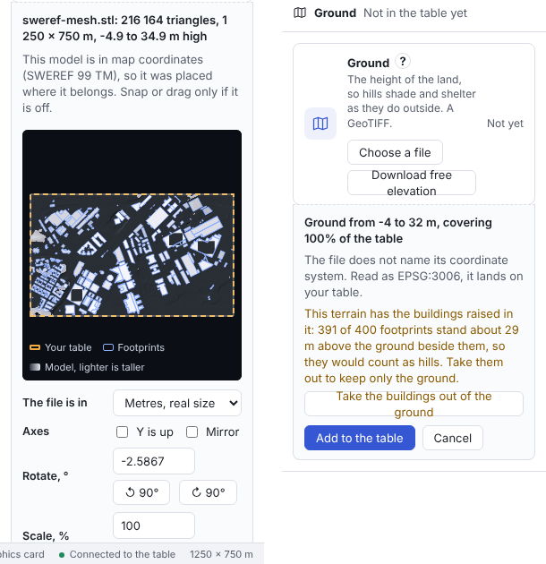

## 0.25.0 (2026-11-24)

### New

#### A network's Time slider shows the hour the table is playing (#338)

The Time slider of a network of flows used to read a share, "40 %". It now shows the step's own time, such as "19:00", as the table plays and as you scrub. Any range control can do the same with `"shows"`, naming a value its layer publishes. A slider among a layer's main choices is also longer, with its value in larger type.

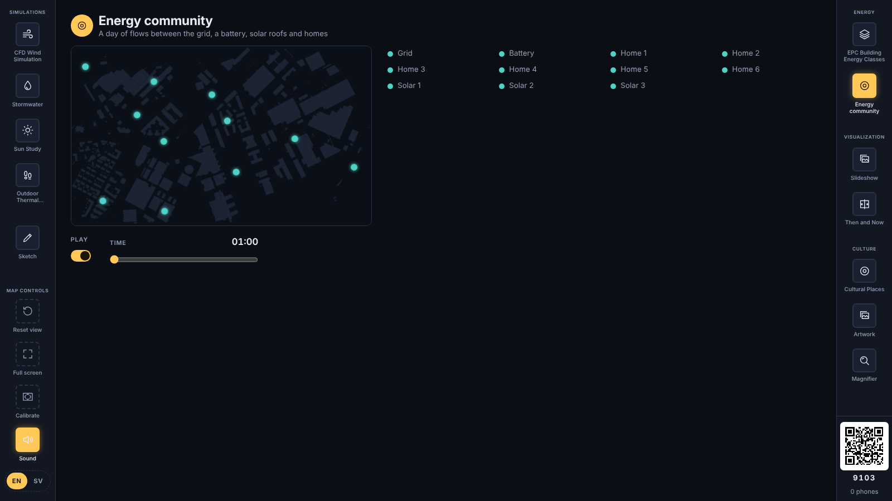

#### A custom layer shows its map and places on the controller (#342)

A custom layer, such as Cultural Places, used to leave the centre of the controller empty, still saying "Turn a layer on to see it here". Now it shows a small map of the layer's data in the table's colours, over the table's buildings, and, for a layer of named points, its places by name and category, the one the table is showing marked. The message only shows when no layer is open. A long row of choices, like the eleven animations, now wraps instead of running off the screen.

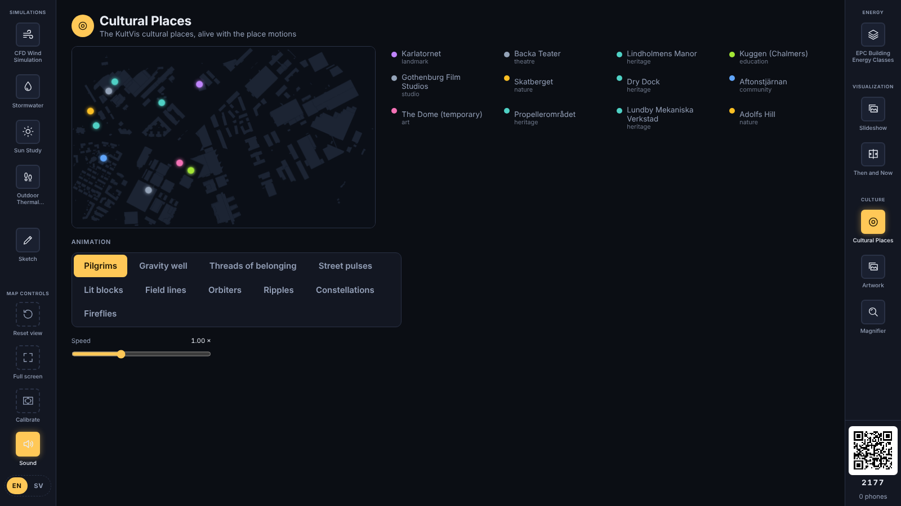

#### Share a table by email, and update it on the studio PC (#372)
A **Share** button at the top right of the editor (also File, Share by email) packs the table into one `.mrstable` file and opens a new email in the computer's own mail app with the file attached: through Compose Email on a Mac, Simple MAPI on Windows (Outlook and other desktop mail apps). Big files are left to the mail app; Outlook offers to send them as a OneDrive link. When no mail app takes the file, it is shown in its folder beside a new email to drag it into. Keys never go in the file. On the studio PC, opening a file of a table it already has now asks: **Update it** replaces the content, keeps that computer's calibration, history and kept map pictures, and puts the earlier version in the Trash; **Keep both** opens a second copy as before.

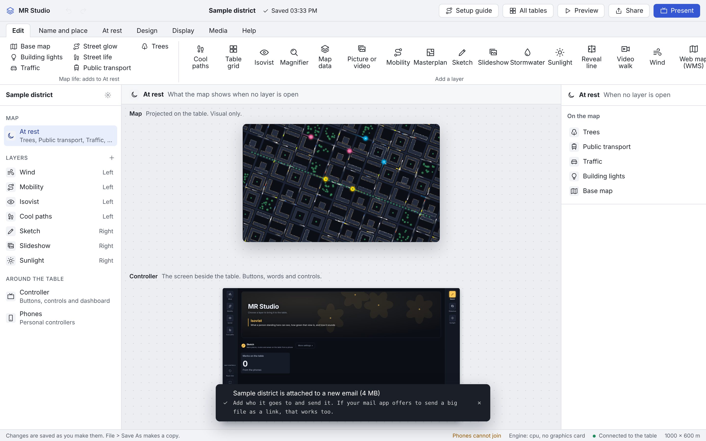

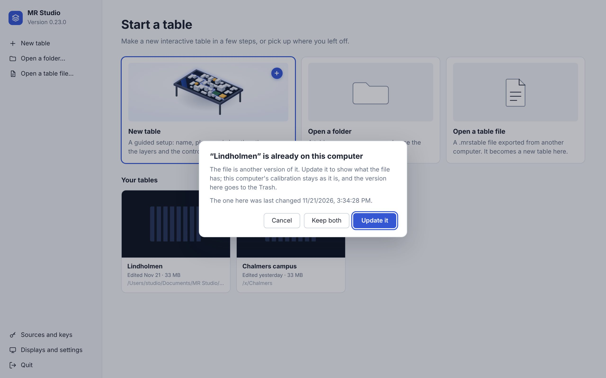

#### The layer builder's Interaction tab: tap to read, show only, visitors can change (#38)

A custom layer can now be picked on the table, with its facts on the controller (Tap to read), filtered by a category or a number (Show only), and given sliders for its size, glow or strength (Visitors can change).

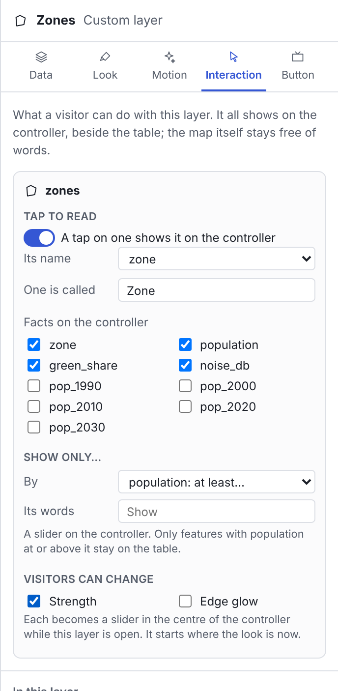

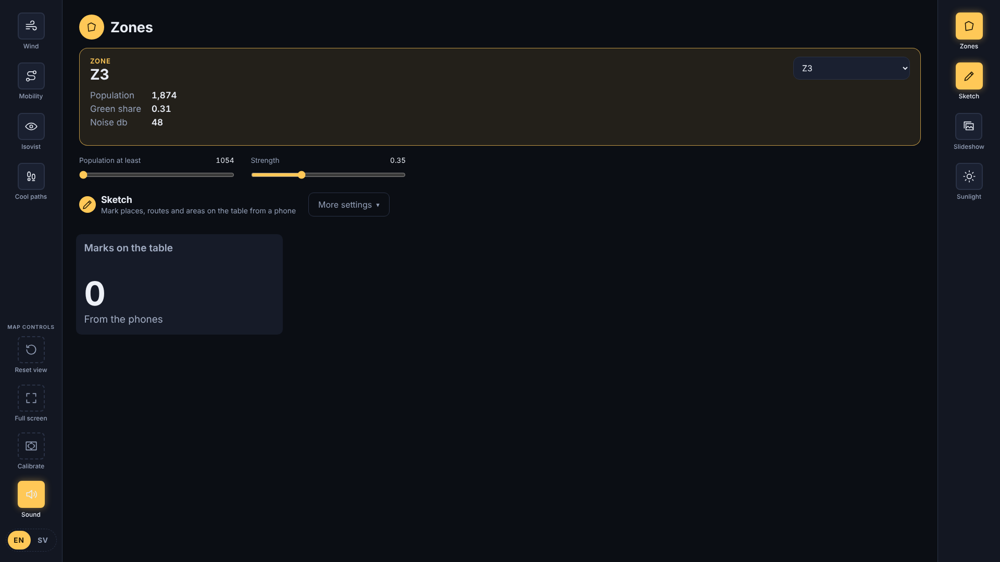

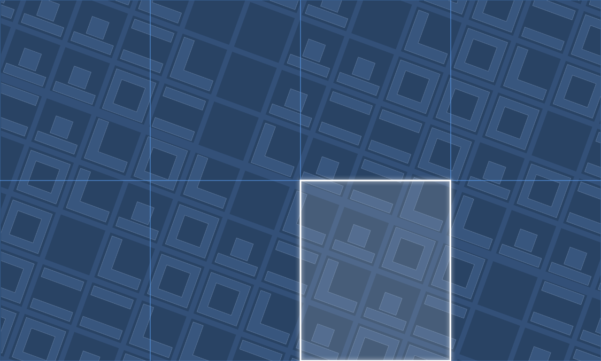

#### The table's data in the editor's tree (#52)

A Data group at the bottom of the tree lists every dataset. Each one can be made into a layer, replaced with another file, or taken out of the table; taking out is refused while a layer still uses it, naming that layer.

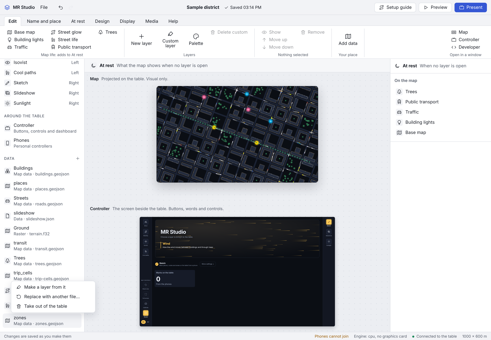

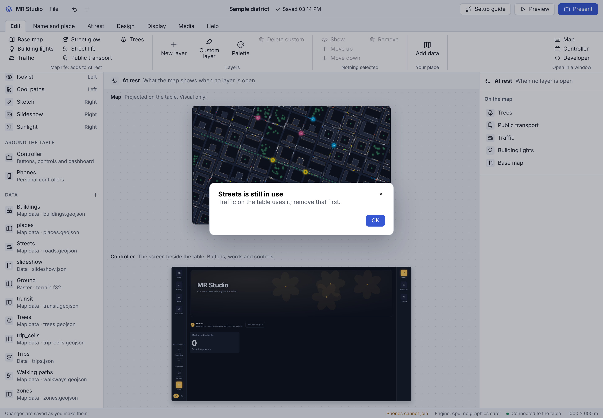

#### A New layer gallery with a picture of each layer (#59)

New layer (in the ribbon, or the + in the tree) opens a gallery: layers from your data, analysis, story, make your own and map life, each with a picture of it on the table and a search. A layer that needs data the table has not got says so, with a button to bring it in.

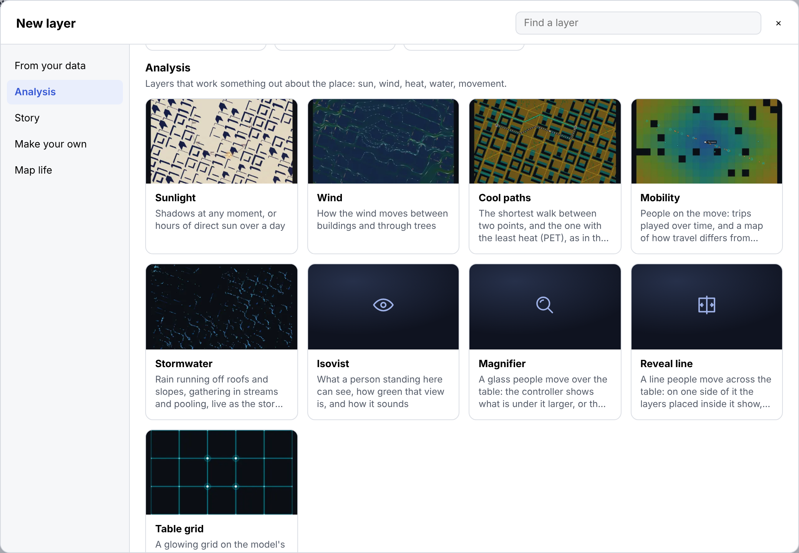

#### The controller and TV in the table palette's colours (#93)

A "Table palette" theme (Design tab), or "The controller in these colours too" in the palette dialog, gives the controller and TV the palette's accent and data colours, and follows the palette as it changes.

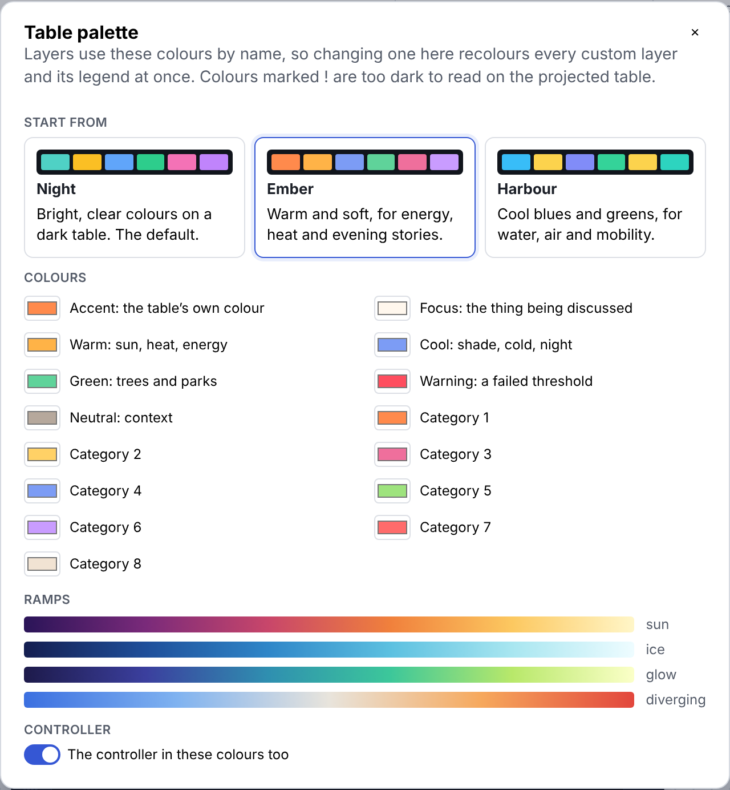

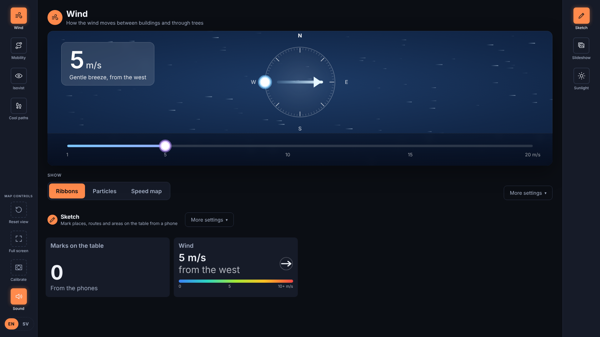

#### Your own class edges and a middle value when colouring by data (#94)

When data is brought in and coloured by a value, pick a ramp (including a diverging one), type your own class edges, and set the middle value a diverging ramp is centred on.

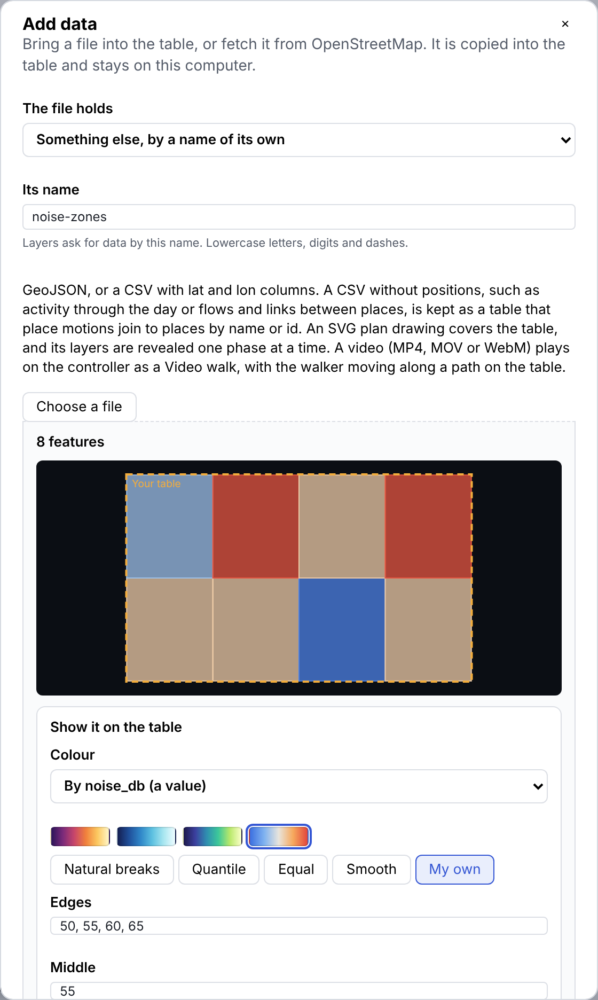

#### Values that change through time, and the year on the controller (#95)

The Through time motion can now colour a layer by values that change year to year (one column per year), not only reveal features. The controller shows "Now showing" with the year, and a Play switch with a slider to hold any moment.

## 0.24.0 (2026-11-24)

### New

#### Install the mrstudio command for terminals (#370)

The `mrstudio` command has come inside the app for a while, but a terminal could not find it. **Displays and settings** now has a **Command line** tab with **Install command line tool** (also in the MR Studio menu on a Mac, and the editor's File menu on Windows). On a Mac it links `/usr/local/bin/mrstudio` to the copy inside the app, asking for the password once, and the link follows the app through updates. On Windows it adds the MR Studio folder to your own PATH, with no administrator needed. **Remove** takes it away again. The tab says why you would want it: checking a table, bringing data in, building a layer of your own or packing a table from a terminal, a script or an AI assistant. `scripts/install-latest-mac.sh` makes the link too.

## 0.23.0 (2026-11-24)

### New

#### Golden hour on the sun study (#363, #81)

Sunlight has a new **Golden hour** choice under Show. The table plays the evening (or morning) golden hour on a slow loop: honey light turning ember orange as the sun meets the horizon, long violet shadows with a warm rim, then a moment of blue hour before it starts again. The controller's sky turns to dusk and marks both golden hours on the timeline, with their times.

#### Sliders, toggles, choices and buttons on panels (#354)
A panel can now hold one of its layer's controls: a slider, a toggle, up to three choices side by side, or a button for an action. It takes its label, range and choices from the layer, so they are written once, and it changes the table exactly as the controller's own control does. With this a view of the controller or the TV can be put together from panels alone, the first step towards custom controller views without code. On the table's ribbon a control only shows its value. A team's own widgets can be controls too.

#### A map of the site on a panel, with no code (#355)
A panel can now be the site's map: chosen datasets in the theme's data colours, the table's outline, shapes a layer publishes on top, and a tap that picks one of the layer's things (a building in the energy community) or sends a point to one of its tools. The table answers exactly as if the visitor had tapped the table: the picked building is outlined there and its controls open on the controller. It is the same map a layer's own controller stage gets from code, so a custom controller view with a map no longer needs any code.

#### Five more widgets: gauge, list, donut, picture or video, and legend (#356)
Panels can now show one value against its range (a gauge with a target tick), a short ranked list, the shares of a whole as a ring with a headline in its middle, a picture or a silent looping video from the table folder, and a layer's legend. Each comes in the sizes it reads well at, counts against the density budget, binds to what a layer publishes and follows the theme. A list or a donut holds fewer rows in a smaller panel, so nothing gets squeezed.

#### A layer's controller view made of panels, with no code (#357)
A layer can now lay out its own controller view in layer.json: `"stage": { "panels": [...] }` puts dashboard panels in the controller's centre, with the same widgets, sizes, bindings and density budget as the TV. With the map, control and gauge widgets and a layer's own team widgets, a custom controller view (a map to pick buildings on, the grid link, the share slider, the optimiser button) needs no module code. The generated control rows step aside unless `"controls": true`. The TV strip under a tall stage now stays blank instead of saying "Turn a layer on" while one is on.

#### The Developer window is now a workbench for layer and widget authors (#358)
The Developer window (Open in a window > Developer) now opens with a workbench of five tabs beside the live table; its **Workbench** button hides it:

- **Widgets:** every widget, the site's team widgets too, at every size with made-up data, with what each size costs against its budget.
- **Live values:** what each layer publishes and its params as they change. A click copies the binding for a panel.
- **Controller:** the 46-inch controller at its real layout, scaled to fit.
- **Action log:** actions, tool inputs and param and entity edits, with their round trip.
- **Problems:** refused panels, bindings to values a layer hasn't published, and what layers complained about.

#### Layers say when they are in trouble, and heal themselves (#259, #260)

A layer that cannot start, or cannot read its data, is never silently missing any more. It tries again by itself (after 1 s, 2 s, 5 s, 15 s, then every minute), so putting a missing file back or waiting out a restart is enough. Meanwhile the editor shows a red dot on its row, with why ("couldn't read walkways.geojson") and a **Retry** button, and the controller dims its button with "Not available right now". The start and end of the trouble go to the operator log.

#### Diagnostics you can send

Errors in the table, controller, editor and phone windows now reach the app's log, so a problem at a site can be seen without the developer tools. **Help › Copy diagnostics** (also on the editor's Help tab) gathers one report to paste into an issue: the version and build, the table, how each layer is doing, the windows' frame rates, errors, incidents, the displays and the end of the app's log. Keys are never in it. **Save diagnostics…** writes it to a file and **Open log folder** shows the logs.

### Fixes

#### Map life stays on show after switching the base map off and on (#368)

Switching the base map off and on again in the At rest tab (or the guide's At rest step) put it back on top of the trees, traffic, public transport and building lights, so they seemed to vanish. The base map now goes back to the bottom, under the map life.

## 0.22.0 (2026-11-24)

### New

#### A team's own widgets, held to the same rules as the built-in ones (#353)
A layer package can now bring its own kinds of panel. Its code makes them with `defineWidget` and lists them in `widgets`; MR Studio checks each one (sizes, a label on every setting, a cost in reads) and adds it to the one set of widgets the controller, the TV pages and the table's ribbon share, as `<layer>/<type>`. The layer's own panels name it by its short name. It counts against the density budget, binds to what layers publish and follows the theme like any built-in widget, and one that breaks only breaks its own panel. The model-runs sample shows the grid draw as a line into the community that thickens with it, on the controller and in the ribbon. Built-in widgets stay for what most tables need; a widget two teams have each written moves into the built-in set. Also: sound beds no longer fill the window's console with warnings before the first tap.

### Fixes

#### The MCP server knows the latest table features (#349, #231, #156)

An LLM designing with the MCP server now finds the Reveal line's then-and-now mode (two layers, one on each side of the line), the controller's Ribbon button and the Stormwater ribbon, and the logo on the controller and phones, and it describes the Magnifier as it now works (the controller shows the glass). A layer's data needs now point to `import_data`.

## 0.21.0 (2026-11-24)

### New

#### Every phone is an animal with a fun name (#339)

A phone that joins becomes "Sunny Fox" or "Brave Owl": an animal nobody else at the table has, on that phone's colour. Tapping it lets the visitor type a name of their own or pick another animal. The controller shows each phone's animal under the QR code, faded while it reconnects, and says "Ada turned on Wind" when a phone switches a layer. Names are in Swedish too.

## 0.20.0 (2026-11-24)

### New

#### The table's logo on the controller and on phones (#156)

Pick a logo in Table settings from the table's pictures, or add one there. It shows above the title on the controller's welcome screen and beside the title on every phone.

#### Choose which ribbon the table shows (#231)

When more than one open layer has a ribbon, a **Ribbon** button appears under Map controls on the controller. Each press moves from Auto to each of those layers in turn. The choice holds until that layer closes. Stormwater now has a ribbon too: time into the storm, rain so far and water on the ground.

#### Download an example of each kind of file (#36)

The **?** on every Your place row and in Add data now has **Download an example**: a small file of that kind (buildings, trees, streets, walking paths, trips) made around your own table, so you can open it to see its shape or bring it straight back in and see it on the table. The same words are in the guide (Bring in your data, What a good file looks like) and in the MCP server as `mrstudio://data-formats`, all from one list.

#### Duplicate a table, or the example, from Home (#99)

Every card under Your tables has **Duplicate**. It makes a copy named "… copy" with its own id, next to your other tables, and outlines it. Duplicate the example that comes with MR Studio to start from a working table instead of a blank one, then move it to your own place.

## 0.19.0 (2026-11-24)

### New

#### The Magnifier works as the artwork's did, and the Reveal line can show then and now (#349, #351)

The Magnifier now works the way round the Lindholmen artwork's did. The table marks the circle being looked at and darkens the rest, with the old warm halo and fine rim. The controller shows that circle larger, through a glass that bends the picture at its rim, with a small table picture beside it to move the circle. A Masterplan drawing is drawn again sharply for the glass. The X-ray stays on the table.

The Reveal line can now show two layers, one on each side of the line, with **With two layers inside, the second shows on the other side**. For example, the 1960 aerial photo on one side and today's on the other.

For layer authors: `ctx.view` sends a picture from the table to the layer's own controller, `ctx.map.addDetail` and `ctx.map.detail` draw a layer again sharply for a magnifier, and `ctx.reveal.item` gives one item a shape of its own.

## 0.18.0 (2026-11-24)

### New

#### The MCP server guides a developer through a site code layer (#284)

For the ideas that need code, an LLM can now build a team's own layer with them, the way a layer like ECOM is built: blocks first, code last. `create_layer` starts one in the site with `mrstudio layer new`. `sdk_reference` looks up what `@mrstudio/sdk` really exports, read from its source, so code is written against what exists. `check_layer` applies the layer rules: the TV's density budget, every word in Swedish, no places written into code, no talking to surfaces behind the host's back, only the SDK from the core, and the data, services and kernels the layer needs. `build_layer` bundles it and returns the build's errors, `preview_layer` says how to see it in the dev view, and `add_service` declares a model the host starts beside the table. New prompts: `build_code_layer` and `build_controller_app`.

## 0.17.0 (2026-11-24)

### New

#### Sound that follows the data, and a Sound switch on the controller (#282)
A layer can now carry a sound bed in its layer.json, with no audio code: up to four slow voices (a band of filtered noise, a hum with harmonics, or a plain tone) whose loudness and colour follow a value the layer publishes or one of its controls. The model-runs sample hisses and hums louder as the community draws more from the grid. The bed keeps to the rules learned at the table: one level ceiling for all the voices together, slow glides and no repeating beeps. It plays on the table only. A new **Sound** button under Map controls on the controller mutes the table for the session, voices and sounds on points alike, while the rings that follow the sound carry on. How to write one: docs/contracts/layer.md, Sound voices.

#### Phones turn layers on and off (#335)

Visitors' phones now list every layer with an on/off switch, and show each layer's main controls, so a phone can open Wind and set its speed. Opening a layer from a phone closes the open one, as the controller's buttons do, and the controller says which phone did it with a dot in that phone's colour. A table can turn this off in Table settings ("Phones can switch layers"), phones leave the layers alone while a slideshow is showing, and a layer can keep itself to the controller with `"phone_switch": false`.

## 0.16.0 (2026-11-24)

### New

#### The MCP server brings data in with the editor's own import code (#320)

An LLM can now put a team's data on the table without anyone opening the editor. `import_data` checks a file (GeoJSON, CSV, zipped Shapefile, GeoTIFF) or fetches OpenStreetMap or free elevation for the table's area, exactly as Add data does: it detects and reprojects the coordinate system, says how much lands on the table, and refuses what would not work, such as latitude and longitude swapped, with the fix to try. With `write` it saves the file and points `site.json` at it. `add_media` and `add_sound` copy pictures, video and sounds in, and `list_site_files` shows every dataset with its columns, bounds and which settings use it. Behind them is a new `mrstudio data` command (`add`, `media`, `sound`), which the installer now puts beside the app so the MCP finds it.

## 0.15.0 (2026-11-24)

### New

#### Compare scenarios and show a balance, on the controller and in the ribbon (#281)
Two new dashboard panels say what a crowded dashboard used to. **Compare** puts two or three scenarios side by side, such as "as today", "this plan" and "the best share", with one figure each and how far each is from the first. A scenario that is not worked out yet says **Not run** or **Working…** instead of showing an old number. **Balance** shows where something came from and where it went, as two bands split by share, with one headline number such as self-sufficiency. Both bind to what a layer publishes, count towards the density budget, follow the theme, and come as chips for the table's ribbon. The model-runs sample (`samples/service-example`) uses both.

## 0.14.0 (2026-11-24)

### New

#### Networks of flows, made in the layer builder without code (#280)
A custom layer can now show a network: its points are the nodes, a links table joins them, and a time series says how much flows along each link hour by hour. Links widen and carry lights as busy as the flow, going the way it runs, in the colour of the node they leave. Rings travel out of a node that gives and into one that takes, and a gauge fills round a node with a level, such as a battery. Links without a line of their own follow the streets. The controller gets **Play** and **Time**, so a visitor can pause the day and scrub through it. The same picture fits an energy community, district heating, stormwater pipes or commuter flows. To try it, pick **Energy network** under test data in **New custom layer**: a grid, a battery, solar roofs and homes over a day.

#### Development requests from the MCP server check for duplicates and are ready to build (#328)

When an experience needs something MR Studio cannot do, the MCP server now writes an issue a developer can act on: a kind (layer enhancement, new layer, block, kernel, data integration, interaction, site setting, SDK or runtime, architecture, other), the context, a user story, the proposed functionality, what the table, controller and phones do, technical considerations, acceptance criteria, dependencies and current limitations. `find_related_issues` and the draft search open and closed issues first, and `submit_development_request` searches again and holds back a likely duplicate unless the person says it differs. One yes can send a batch. Issues get `development-request`, their kind and `needs-triage`, and are added to the build order in #49 at triage. An issue number is reported only when GitHub returned it; without a sign-in or permission nothing is sent and the prefilled link comes back. A new issue form, `development-request.yml`, matches the sections. `check_layer_idea`, `list_building_blocks`, `draft_module_request` and `submit_module_request` still work for this release only.

#### Connect Claude and other AI apps in a minute (#324)

Every release now carries a Claude Desktop extension: download `mr-studio.mcpb`, double-click, and Claude can build tables in your tables folder. ChatGPT Codex, Cursor, VS Code, Gemini CLI and other AI apps connect with one command, `npx -y @mrstudio/mcp`. A new Help guide, Build a table by talking to Claude, shows the steps for each app and a conversation from a rough idea to a finished table.

## 0.13.0 (2026-11-24)

### New

#### The MCP server designs a whole experience, builds what exists and names what does not (#327)

An LLM can now take one sentence, such as "residents understand how the proposed development changes sunlight and wind, and contribute ideas", and turn it into an experience plan: steps with what the table shows, what the controller says, what phones do and the guide's notes, plus layers at rest and other needs. `assess_experience` checks the plan against the capability catalogue and says, for each step, which layer serves it, what setup it still needs, which constraint it runs into (no 3D on the table), and which gaps need a development request of which kind. `build_experience` writes the parts that exist in one validated change, including a guided sequence with notes, and never writes a gap into `site.json`. New prompts: `design_experience`, `plan_workshop`, `compare_scenarios` and `build_from_data`; `new_project` now starts from the experience, and `check_layer_idea` also returns its idea as a one-step plan.

## 0.12.0 (2026-11-24)

### New

#### A layer's own map app on the controller (#283)
A layer can now put its own app in the middle of the controller, such as a map of the site to choose on. What visitors do there reaches the table: a tap can draw a route, and a button can start an animation. The SDK gives layers a ready map of the site, upright as the table stands, with its streets and buildings, and it can find the shortest way along the streets. `samples/controller-map-example` has a route planner: tap a start and an end on the controller, the route lights up on the table, and **Send a traveller** sends a light along it.

#### The MCP server knows what each part of MR Studio is for, and what it cannot do (#326)

An LLM can now design an experience before it builds one. `find_capabilities` takes a goal in plain words and returns the layers, building blocks, kernels and site features that serve it, ranked, each with its status from the code (available, needs setup, planned, unsupported), what it needs, what the table, controller and phones do, what it pairs with, and the files that prove it; `describe_capability` gives one in full. Every core layer now says in its `layer.json` what it is for, the questions it answers, what it pairs with and its limits (`about`), and CI checks them. New resources give the three surfaces and eight experience patterns (`mrstudio://concepts`, `mrstudio://patterns/<id>`, from [docs/experience-design.md](docs/experience-design.md)), the catalogue, the site and recipe schemas, and the example sites. `save_custom_layer` works out the controller's legend from the looks and their data, as the editor does. Roadmap rows that are already built (ambient cars and people, dark and light maps, guided tours, annotations) are marked built.

## 0.11.0 (2026-11-24)

### New

#### Tap a building on the table, change it on the controller (#279)
A layer can now list things visitors change one at a time, such as the buildings of an energy community. Tap one on the table and it lights up. The controller then shows its name and its own settings, like whether it is in the community and how much of its roof has solar panels. Visitors can also pick one from a list, put it back to how it was, or apply its settings to every building of the same kind. Changed buildings get a dashed outline on the table. The layer needs no code for any of this: it only reads the values, and it can wait for a slider to settle before asking a model again. `samples/service-example` now works this way.

#### Where is it sunny at 5 pm? (#273)

Sun hours and Seasons can count just part of the day: the morning, lunch, the afternoon or the evening. Pick Evening and the terraces that get the evening sun light up.

## 0.10.0 (2026-11-24)

### New

#### The MCP server tells the truth about what exists, and refuses what would not draw (#319, #321, #322, #323, #325)

An LLM connected to MR Studio no longer asks for modules that already exist: the planned kernels are only real planned kernels, and naming a layer (such as `transit`) as a kernel finds that layer. Custom layer recipes are checked against the recipe player (blocks, props, colours, ramps, pictograms, icons), files named by layer params must be in the site, and a refusal never reads as a success. Every tool now returns structured results with one error shape and full MCP annotations. `preview_site` explains how to open the site in the installed app, or gives a `mrstudio dev` command on a free port with the app's own surfaces, and lists the editor and guide's phone. Presenter `notes` on slideshow steps are documented in `set_steps` and the site contract.

## 0.9.0 (2026-11-24)

### New

#### Name and place, At rest and Design tabs on the ribbon (#311, #312, #313)

Three steps of the setup guide are now tabs on the editor's ribbon, so a table can be changed without walking back through the guide. **Name and place** renames, moves, resizes or turns the table, and says what a move does before you press Move the table. **At rest** switches the map life on and off. **Design** has the controller's theme gallery, the button style, and each button's words and side.

## 0.8.0 (2026-11-24)

### Breaking changes

- A table with "services" in its site.json opens only in this version or newer; update the app on every computer that runs it. (#278)

### New

#### Fetch everything from open data in one go (#310)

A new table's **Your place** step starts with **Fetch everything from open data**: buildings, streets, walking paths and trees from OpenStreetMap and the ground from free elevation, ticked and fetched together. OpenStreetMap is asked once for all of them, which is quicker and kinder to its shared servers than one request per dataset. One list shows how each one is doing, the editor reloads once at the end, and anything that failed has its own **Try again**. Datasets already on the table start unticked, so nothing is replaced unless you ask.

#### Models that run beside the table (#278)
A table can now start its own models, such as an energy optimiser in Python, every time it opens. It keeps them running, restarting any that stop, and its layers ask them for answers. Long runs show their progress on the controller. If a model is down or the table is offline, the table shows the last answer it got. `samples/service-example` has a small model and a layer that uses it.

### Fixes

#### The sun glides through the day (#302)

Playing the sun study no longer jerks. The table now keeps its own clock while the day plays, so the sun, its glow and the shadows move a little every frame instead of jumping each time the time came back from the host. Shadows are drawn without stalling the frame, and on a slower graphics card they are drawn a little less often rather than slowing the whole table. The controller and the TV still follow the time a few times a second.

Sunset is calm now too. The day slows to a third of its speed near sunrise and sunset, when shadows race across the table, so the golden hour gets its time. Long low shadows are drawn a little softer, and after sunset the table fades into night instead of switching back to the bright map.

## 0.7.0 (2026-11-24)

### New

#### A Media tab, and lists instead of names to type (#306)

The editor's ribbon has a **Media** tab with everything the table can show: map data, drawings, pictures, video, sounds, the 3D model and the online sources of this computer. Each has a preview and says which layers use it, and goes on the table with one click. **Add media** takes any file, and the files a table is made from can be brought in or replaced here as in the guide's Your place.

Settings that named a dataset, a file, a column or a WMS layer were boxes to type the exact name in. They are now lists to pick from, with type-ahead: a name that is not in the table is refused, so a typo can no longer leave a layer empty.

#### Try a custom layer with test data (#308)

No data yet? The New custom layer window now offers random points, places, lines or areas, made up on the spot inside your table with columns to colour, size and animate by. Random places come with a day of activity, flows and links and start with a place motion, so you can switch through every place motion, cultural gravity included, straight away.

## 0.6.0 (2026-11-24)

### New

#### Artworks that draw themselves, a magnifier and X-ray, and a reveal line (#286, #287, #288, #289)

The Lindholmen artwork is now made of parts any table can use. A plan drawing can trace its lines in, turn to colour and grow viewpoints one at a time, placed on the map by its corners, and shows on the controller too. Pointing at a part of it lights it.

The new Magnifier is a glass people move with the mouse, the controller or a phone. It shows the table larger, or, as an X-ray, the layers placed inside it, such as pipes and tunnels under the street.

The new Reveal line is a line people drag across the table, with the layers inside it showing on one side.

Large parts of the map can now start an animation when a pointer rests over them, ready for the camera's hands later.

#### Plans that come to life part by part (#300)

A masterplan drawn with its parts named by what they are now animates each part the way the Chalmers demo's Campus Vision did. The boundary traces and its dashes march, the main axis grows from its middle, routes are drawn one after another, points pop in, nodes grow their rays and green spaces breathe. Phases numbered in their names are revealed in that order. There is a template drawing in the sample kit.

### Fixes

#### The + beside Layers opens a list of layers to add (#305)

In the editor, the **+** next to **Layers** on the left looked like it did nothing. It now opens a short list under it with every layer the table can add, then **Custom layer…** and **Add data…**. Picking one does the same as the ribbon's tool: a layer that needs data first takes you to bring it in, and adding a layer the table already has still asks first. Esc or a click elsewhere closes the list.

## 0.5.0 (2026-11-24)

### New

#### Opening a layer quiets the map at rest (#303)

When a layer is opened from the controller, the life on the map at rest steps aside: traffic, street life, public transport, building lights and trees pause, and the base map stays underneath for context. Close the layer and everything at rest comes back, as Street Life did in the Chalmers demo. The slideshow and picture layers still hide the base map too. Sketch and other tools kept alongside don't count as an open layer.

#### Your own layers, with code, in the installed app (#277)
A table can now carry layers its team wrote, with their own drawing on the table and their own panels on the controller, without changing MR Studio. `mrstudio layer new` makes a working layer in the site's `layers/` folder, `mrstudio layer build` gets it ready, and the app loads it next to the built-in layers. Developers write against the same SDK as the core layers. The table's computer runs the built layer and needs no extra tools.

## 0.4.2 (2026-11-24)

### Fixes

#### Every table shows its own buildings and trees (#222)

In the desktop app, a table could open with its streets and traffic but no buildings, trees or building lights. All tables use the same addresses for their files, and the app's window kept copies from an earlier table. A table whose files were older than those copies, such as one copied from a repository, was given the earlier table's buildings and trees, which lay somewhere else. The app now always fetches a table's files fresh, and it checks its own pages on every load, so an updated app never shows an earlier version's page.

## 0.4.1 (2026-11-24)

### Fixes

#### Esc always leaves Present (#295)

Esc takes you out of a full-screen Present, back to the editor, also when the table was opened without the editor. The full-screen screens now get the keyboard straight away, and the table shows a "Back to the editor" button when the pointer goes to its top edge. A table that starts by itself with the computer still ignores Esc.

## 0.4.0 (2026-11-24)

### New

#### Phones join on eduroam and mobile data (#275)

Visitors scan the QR code as before, from any network: the code opens a small join page on GitHub Pages that connects to the table over WebRTC, with no router or server of our own. The phone page itself still comes from the table, so it always matches. Join page link v1.

## 0.3.0 (2026-11-24)

### New

#### A Help page for every layer, and what to do when something is wrong (#291)

Every layer now has its own page in the Help window. Each page says what the layer shows and what it is good for, and walks through setting it up step by step. It also lists what data the layer needs, every setting with its range and starting value, and some tips. The settings come from the layer itself, so the page always matches the app. In the editor, **How to use it** beside a layer's settings opens its page.

A new page, **When something is wrong**, goes by what you see. It covers a projection that doesn't line up, a window on the wrong screen, an empty layer, phones that can't join, a slow table, missing map pictures, keys, the first start on a Mac or Windows, and updates.

## 0.2.1 (2026-11-24)

### Fixes

#### Present fills the screens you chose (#270)

Present now opens the table and the controller full screen on the screens picked in the Display tab, also on a Mac with a Retina laptop beside a projector or TV, instead of leaving windows half on one screen. A window that ends up off its screen is put back by itself.

## 0.2.0 (2026-11-24)

### Breaking changes

- Tables saved by this version use site format 3 and do not open in older versions of the app; older tables are upgraded when opened and the original is kept beside them as site.format-2.json. Update the app on every computer that opens a table. (#70, #69)

### New

#### Layers with their own ids, items and sequences (#70, #69)

Every layer in a table has its own id, a layer can hold items that show only while it is open, a slideshow can be a sequence of layers, and custom layers are saved in the table. The editor can also hide some of a layer's controls from visitors.

#### Street life at rest (#195)

Walkers on the footways, cyclists on the cycleways, warm streetlights, glowing streets, taxis, buses and now and then an emergency vehicle, while nobody touches the controller.

#### Stormwater, live (#189)

Rain runs off roofs and slopes, gathers in streams and pools in low spots as the storm goes on, computed live on the graphics card.

#### Isovist with Street View and a green soundscape (#190, #82)

Stand anywhere on the table and see what a person there can see, how green that view is, the Street View picture of the spot, and hear how it sounds.

#### Cool paths by thermal comfort (#196)

Cool paths routes the walk with the least heat stress (PET) beside the shortest one, as in the Chalmers demo.

#### Sun study: three seasons and sun at a spot (#252, #256, #121)

Sunlight shows winter, equinox and summer side by side, and tells how many hours of sun one spot gets. Fixed: sun data that went stale after a fast toggle.

#### Guided tours from the guide's phone (#98)

A slideshow of layers gets presenter notes on each step. The guide moves through it from their phone and reads the notes there; visitors never see them.

#### Swedish and English for visitors (#80)

Visitors switch the controller and their phones between Swedish and English. The table's own words are translated under Table settings.

#### Masterplan, phase by phase (#193)

Import a plan drawing (SVG or a picture) and reveal it on the table one phase at a time.

#### Video walk (#194)

A walk filmed on site plays on the controller while the walker moves along their path on the table.

#### Undo, redo and a History panel (#72, #57)

Every change to a table is kept. Undo and redo work across the editor, and the History panel goes back to any earlier state.

#### Phones join from any network (#89)

Visitors' phones join through the relay when they are not on the table's Wi-Fi.

#### Ribbons in the projector's blank space (#78)

At-a-glance strips beside the model, on any side, sized from the table and the projector, with the visitors' side first.

#### More base maps (#37, #42)

Free map styles, maps from your Sources (Mapbox, CARTO, Lantmäteriet, WMS, ArcGIS), black and white, brightness, an offline tile store and the map's credit.

#### Run a table unattended (#79)

The engine restarts itself, a watchdog keeps the windows up, an operator log records what happened, the table can restart every night and the app can start at login.

#### One file per table (#85)

Export a table as one .mrstable file and open it on another computer. Keys never travel in the file.

#### Table settings and app settings apart (#73)

What belongs to the table (name, time zone, welcome line, languages) travels with it; screens, colour and keys stay with the computer.

#### The controller's home and stage (#74, #76, #198)

The home screen loops through the layers by itself and resets after a quiet spell. Each layer's stage has a hero, a legend and large actions, and Map controls and Credits are one tap away.

#### Table grid (#191)

A glowing grid on the model's tile seams, to check that the projection lines up.

#### Shadow trails over the day (#265)

Sunlight draws where the shadows travel through the day, so one picture shows which places stay in the sun.

#### Pictures and videos on the table, and slide transitions (#197, #43)

A picture or video of the site can cover the whole table, on its own or as a slide, and slides move on with a cut, a fade or a dip to black.

#### What's new, on Home (#267, #268, #258)

When a newer MR Studio is out, Home says so and shows each new feature with its picture. Download gets the installer for this computer. After an update, Home shows what the new version brought, once. Every merge is now a numbered release with these notes, and the build stamp (version, commit, date) shows under the name.

#### The MCP server knows what is new (#269)

The MCP server now offers the recent building blocks (marks, place motions, palette, ribbons, sound, languages, guided tours, thermal comfort, isovist and more), a whats_new tool that reads the changelog, and prompts that cover tours, languages and ribbons. Each release carries the matching server as mrstudio-mcp.mjs, and a check keeps the docs and the server in step with what is built.

#### Help in the editor (#271)

A Help tab in the editor's ribbon opens a guide in its own window: step-by-step guides (make a table, set up layers, bring in data, slideshows and tours, the controller and phones, calibration, presenting, sharing) and every layer with a picture. It is built from the same docs as the repository, so it matches the version you run.

