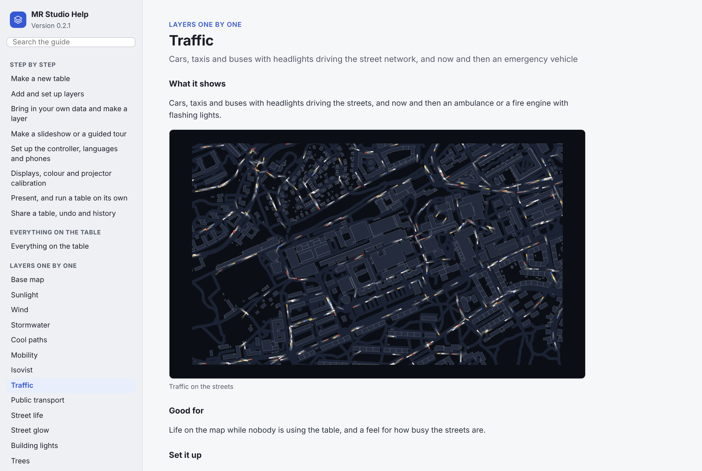
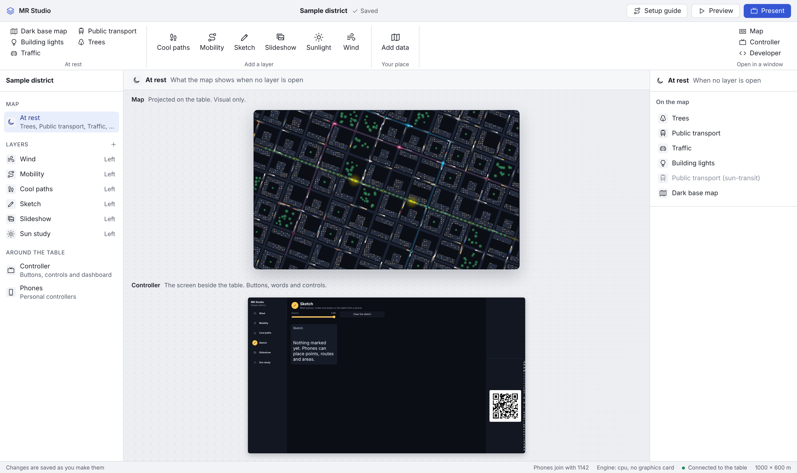
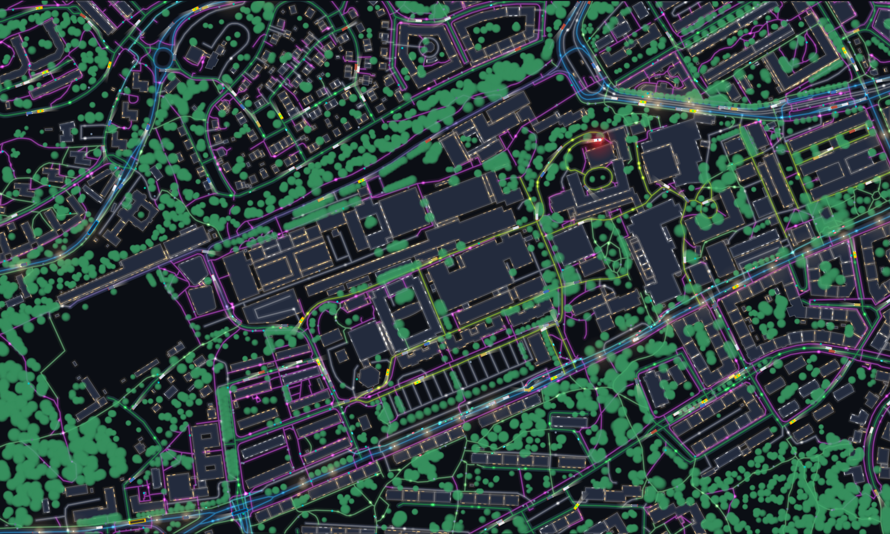
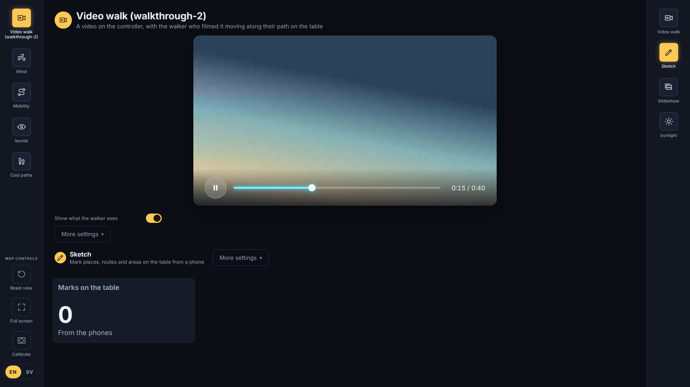
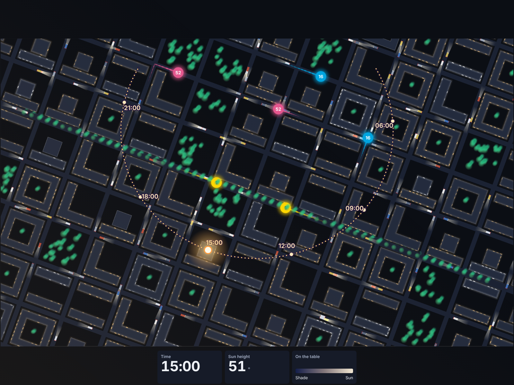
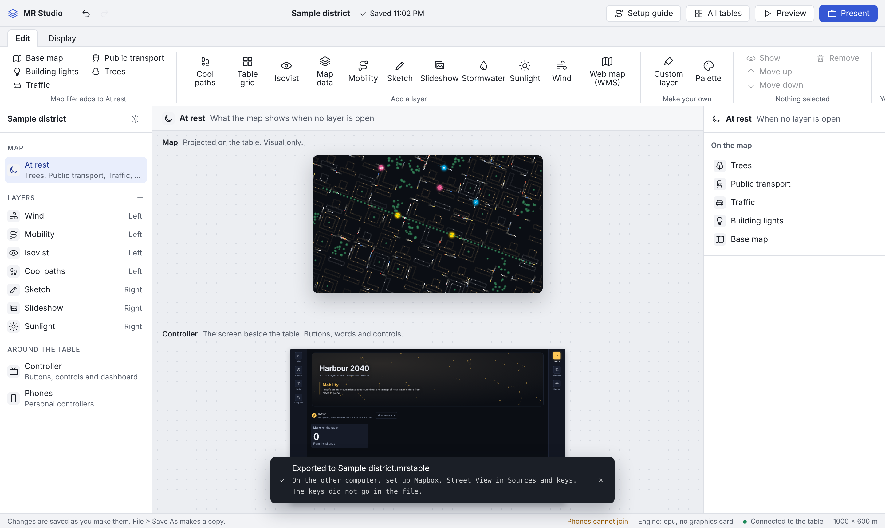
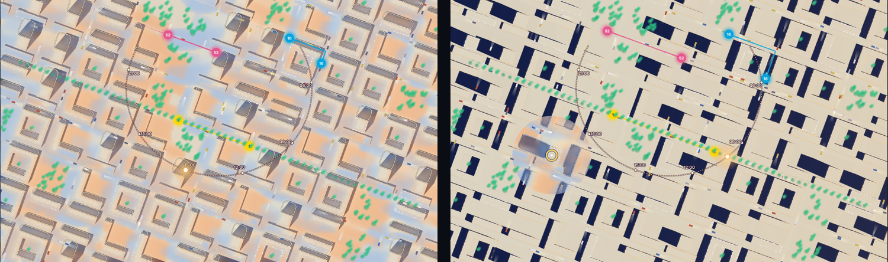
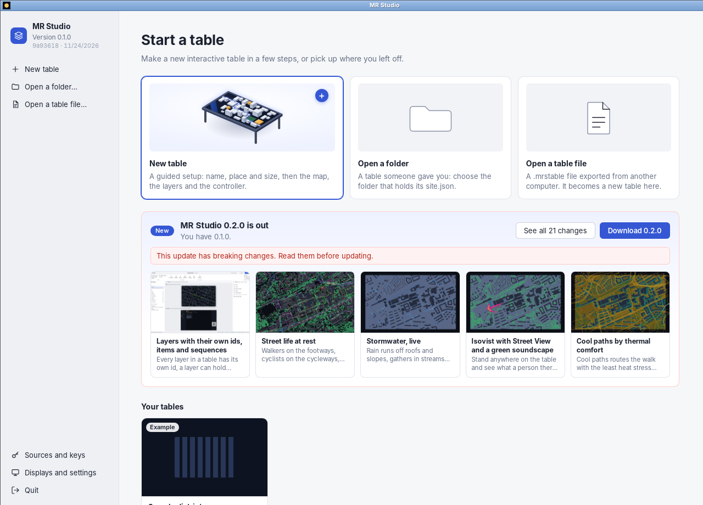

# Changelog

Every merge to main that carries a release note becomes a version. The newest is first.
The app shows these notes, with their pictures, on Home when a newer version is out.
How notes are written: docs/RELEASING.md.

## 0.4.0 (2026-11-24)

### New

#### Phones join on eduroam and mobile data (#275)

Visitors scan the QR code as before, from any network: the code opens a small join page on GitHub Pages that connects to the table over WebRTC, with no router or server of our own. The phone page itself still comes from the table, so it always matches. Join page link v1.

## 0.3.0 (2026-11-24)

### New

#### A Help page for every layer, and what to do when something is wrong (#291)

Every layer now has its own page in the Help window. Each page says what the layer shows and what it is good for, and walks through setting it up step by step. It also lists what data the layer needs, every setting with its range and starting value, and some tips. The settings come from the layer itself, so the page always matches the app. In the editor, **How to use it** beside a layer's settings opens its page.

A new page, **When something is wrong**, goes by what you see. It covers a projection that doesn't line up, a window on the wrong screen, an empty layer, phones that can't join, a slow table, missing map pictures, keys, the first start on a Mac or Windows, and updates.

## 0.2.1 (2026-11-24)

### Fixes

#### Present fills the screens you chose (#270)

Present now opens the table and the controller full screen on the screens picked in the Display tab, also on a Mac with a Retina laptop beside a projector or TV, instead of leaving windows half on one screen. A window that ends up off its screen is put back by itself.

## 0.2.0 (2026-11-24)

### Breaking changes

- Tables saved by this version use site format 3 and do not open in older versions of the app; older tables are upgraded when opened and the original is kept beside them as site.format-2.json. Update the app on every computer that opens a table. (#70, #69)

### New

#### Layers with their own ids, items and sequences (#70, #69)

Every layer in a table has its own id, a layer can hold items that show only while it is open, a slideshow can be a sequence of layers, and custom layers are saved in the table. The editor can also hide some of a layer's controls from visitors.

#### Street life at rest (#195)

Walkers on the footways, cyclists on the cycleways, warm streetlights, glowing streets, taxis, buses and now and then an emergency vehicle, while nobody touches the controller.

#### Stormwater, live (#189)

Rain runs off roofs and slopes, gathers in streams and pools in low spots as the storm goes on, computed live on the graphics card.

#### Isovist with Street View and a green soundscape (#190, #82)

Stand anywhere on the table and see what a person there can see, how green that view is, the Street View picture of the spot, and hear how it sounds.

#### Cool paths by thermal comfort (#196)

Cool paths routes the walk with the least heat stress (PET) beside the shortest one, as in the Chalmers demo.

#### Sun study: three seasons and sun at a spot (#252, #256, #121)

Sunlight shows winter, equinox and summer side by side, and tells how many hours of sun one spot gets. Fixed: sun data that went stale after a fast toggle.

#### Guided tours from the guide's phone (#98)

A slideshow of layers gets presenter notes on each step. The guide moves through it from their phone and reads the notes there; visitors never see them.

#### Swedish and English for visitors (#80)

Visitors switch the controller and their phones between Swedish and English. The table's own words are translated under Table settings.

#### Masterplan, phase by phase (#193)

Import a plan drawing (SVG or a picture) and reveal it on the table one phase at a time.

#### Video walk (#194)

A walk filmed on site plays on the controller while the walker moves along their path on the table.

#### Undo, redo and a History panel (#72, #57)

Every change to a table is kept. Undo and redo work across the editor, and the History panel goes back to any earlier state.

#### Phones join from any network (#89)

Visitors' phones join through the relay when they are not on the table's Wi-Fi.

#### Ribbons in the projector's blank space (#78)

At-a-glance strips beside the model, on any side, sized from the table and the projector, with the visitors' side first.

#### More base maps (#37, #42)

Free map styles, maps from your Sources (Mapbox, CARTO, Lantmäteriet, WMS, ArcGIS), black and white, brightness, an offline tile store and the map's credit.

#### Run a table unattended (#79)

The engine restarts itself, a watchdog keeps the windows up, an operator log records what happened, the table can restart every night and the app can start at login.

#### One file per table (#85)

Export a table as one .mrstable file and open it on another computer. Keys never travel in the file.

#### Table settings and app settings apart (#73)

What belongs to the table (name, time zone, welcome line, languages) travels with it; screens, colour and keys stay with the computer.

#### The controller's home and stage (#74, #76, #198)

The home screen loops through the layers by itself and resets after a quiet spell. Each layer's stage has a hero, a legend and large actions, and Map controls and Credits are one tap away.

#### Table grid (#191)

A glowing grid on the model's tile seams, to check that the projection lines up.

#### Shadow trails over the day (#265)

Sunlight draws where the shadows travel through the day, so one picture shows which places stay in the sun.

#### Pictures and videos on the table, and slide transitions (#197, #43)

A picture or video of the site can cover the whole table, on its own or as a slide, and slides move on with a cut, a fade or a dip to black.

#### What's new, on Home (#267, #268, #258)

When a newer MR Studio is out, Home says so and shows each new feature with its picture. Download gets the installer for this computer. After an update, Home shows what the new version brought, once. Every merge is now a numbered release with these notes, and the build stamp (version, commit, date) shows under the name.

#### The MCP server knows what is new (#269)

The MCP server now offers the recent building blocks (marks, place motions, palette, ribbons, sound, languages, guided tours, thermal comfort, isovist and more), a whats_new tool that reads the changelog, and prompts that cover tours, languages and ribbons. Each release carries the matching server as mrstudio-mcp.mjs, and a check keeps the docs and the server in step with what is built.

#### Help in the editor (#271)

A Help tab in the editor's ribbon opens a guide in its own window: step-by-step guides (make a table, set up layers, bring in data, slideshows and tours, the controller and phones, calibration, presenting, sharing) and every layer with a picture. It is built from the same docs as the repository, so it matches the version you run.

