# Changelog

Every merge to main that carries a release note becomes a version. The newest is first.
The app shows these notes, with their pictures, on Home when a newer version is out.
How notes are written: docs/RELEASING.md.

## 0.15.0 (2026-11-24)

### New

#### Compare scenarios and show a balance, on the controller and in the ribbon (#281)
Two new dashboard panels say what a crowded dashboard used to. **Compare** puts two or three scenarios side by side, such as "as today", "this plan" and "the best share", with one figure each and how far each is from the first. A scenario that is not worked out yet says **Not run** or **Working…** instead of showing an old number. **Balance** shows where something came from and where it went, as two bands split by share, with one headline number such as self-sufficiency. Both bind to what a layer publishes, count towards the density budget, follow the theme, and come as chips for the table's ribbon. The model-runs sample (`samples/service-example`) uses both.

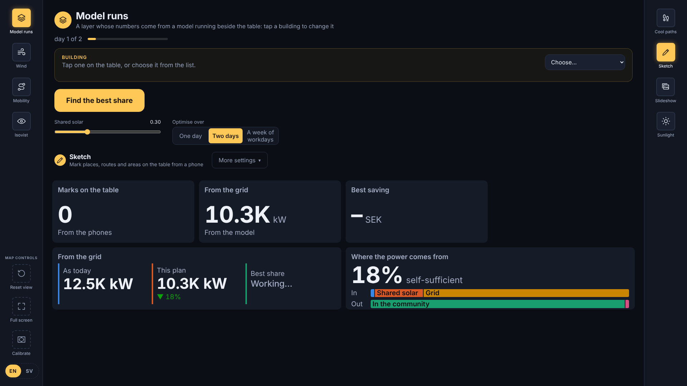

## 0.14.0 (2026-11-24)

### New

#### Networks of flows, made in the layer builder without code (#280)
A custom layer can now show a network: its points are the nodes, a links table joins them, and a time series says how much flows along each link hour by hour. Links widen and carry lights as busy as the flow, going the way it runs, in the colour of the node they leave. Rings travel out of a node that gives and into one that takes, and a gauge fills round a node with a level, such as a battery. Links without a line of their own follow the streets. The controller gets **Play** and **Time**, so a visitor can pause the day and scrub through it. The same picture fits an energy community, district heating, stormwater pipes or commuter flows. To try it, pick **Energy network** under test data in **New custom layer**: a grid, a battery, solar roofs and homes over a day.

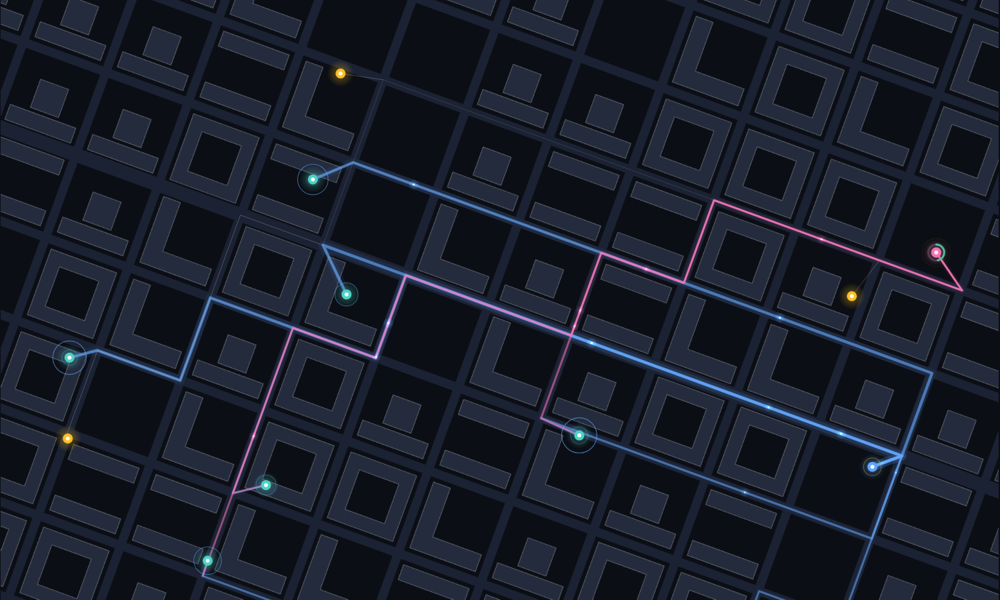
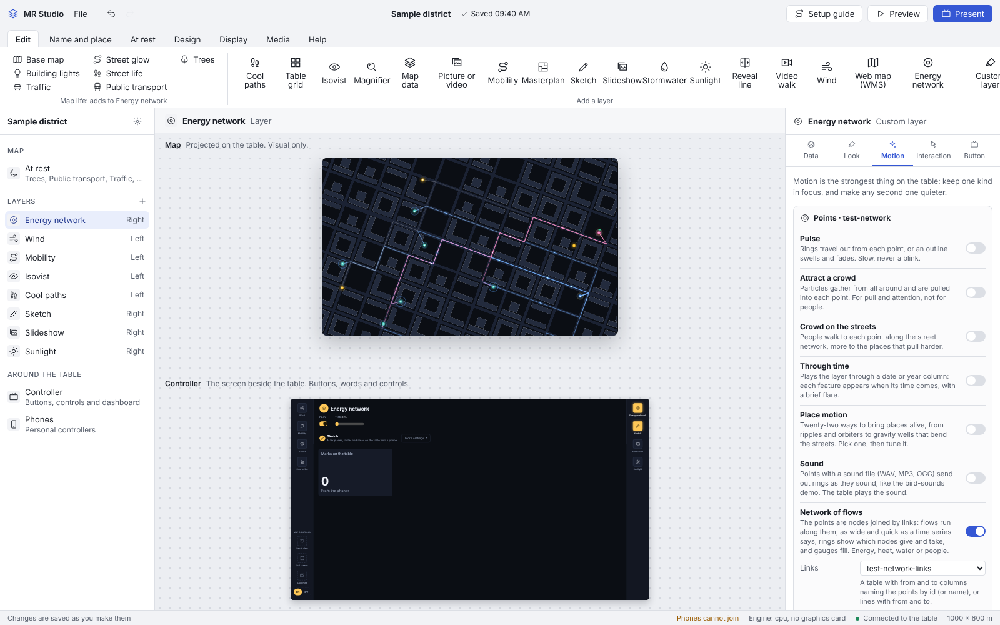
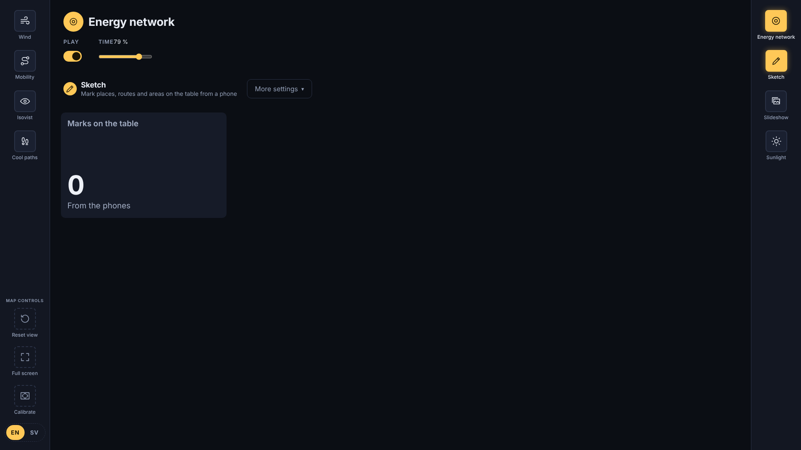

#### Development requests from the MCP server check for duplicates and are ready to build (#328)

When an experience needs something MR Studio cannot do, the MCP server now writes an issue a developer can act on: a kind (layer enhancement, new layer, block, kernel, data integration, interaction, site setting, SDK or runtime, architecture, other), the context, a user story, the proposed functionality, what the table, controller and phones do, technical considerations, acceptance criteria, dependencies and current limitations. `find_related_issues` and the draft search open and closed issues first, and `submit_development_request` searches again and holds back a likely duplicate unless the person says it differs. One yes can send a batch. Issues get `development-request`, their kind and `needs-triage`, and are added to the build order in #49 at triage. An issue number is reported only when GitHub returned it; without a sign-in or permission nothing is sent and the prefilled link comes back. A new issue form, `development-request.yml`, matches the sections. `check_layer_idea`, `list_building_blocks`, `draft_module_request` and `submit_module_request` still work for this release only.

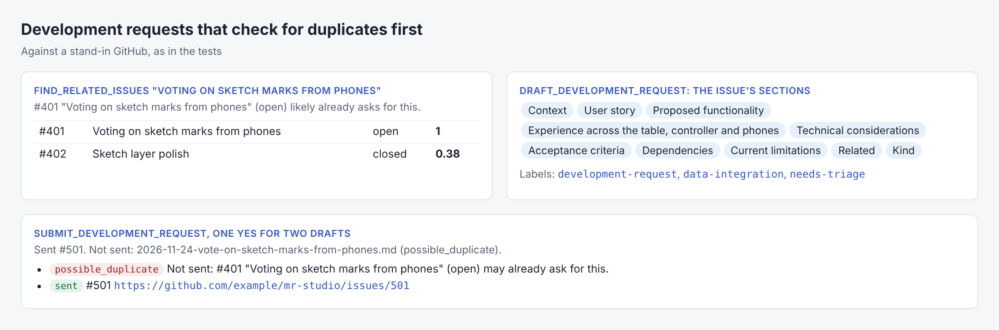

#### Connect Claude and other AI apps in a minute (#324)

Every release now carries a Claude Desktop extension: download `mr-studio.mcpb`, double-click, and Claude can build tables in your tables folder. ChatGPT Codex, Cursor, VS Code, Gemini CLI and other AI apps connect with one command, `npx -y @mrstudio/mcp`. A new Help guide, Build a table by talking to Claude, shows the steps for each app and a conversation from a rough idea to a finished table.

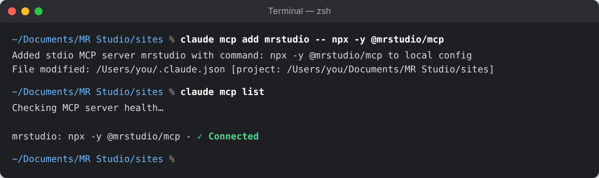

## 0.13.0 (2026-11-24)

### New

#### The MCP server designs a whole experience, builds what exists and names what does not (#327)

An LLM can now take one sentence, such as "residents understand how the proposed development changes sunlight and wind, and contribute ideas", and turn it into an experience plan: steps with what the table shows, what the controller says, what phones do and the guide's notes, plus layers at rest and other needs. `assess_experience` checks the plan against the capability catalogue and says, for each step, which layer serves it, what setup it still needs, which constraint it runs into (no 3D on the table), and which gaps need a development request of which kind. `build_experience` writes the parts that exist in one validated change, including a guided sequence with notes, and never writes a gap into `site.json`. New prompts: `design_experience`, `plan_workshop`, `compare_scenarios` and `build_from_data`; `new_project` now starts from the experience, and `check_layer_idea` also returns its idea as a one-step plan.

## 0.12.0 (2026-11-24)

### New

#### A layer's own map app on the controller (#283)
A layer can now put its own app in the middle of the controller, such as a map of the site to choose on. What visitors do there reaches the table: a tap can draw a route, and a button can start an animation. The SDK gives layers a ready map of the site, upright as the table stands, with its streets and buildings, and it can find the shortest way along the streets. `samples/controller-map-example` has a route planner: tap a start and an end on the controller, the route lights up on the table, and **Send a traveller** sends a light along it.

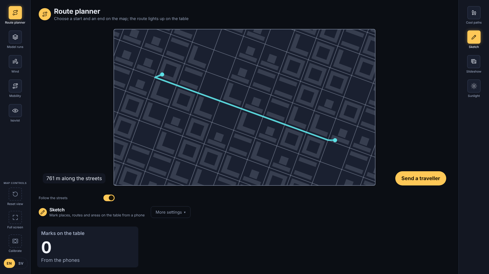

#### The MCP server knows what each part of MR Studio is for, and what it cannot do (#326)

An LLM can now design an experience before it builds one. `find_capabilities` takes a goal in plain words and returns the layers, building blocks, kernels and site features that serve it, ranked, each with its status from the code (available, needs setup, planned, unsupported), what it needs, what the table, controller and phones do, what it pairs with, and the files that prove it; `describe_capability` gives one in full. Every core layer now says in its `layer.json` what it is for, the questions it answers, what it pairs with and its limits (`about`), and CI checks them. New resources give the three surfaces and eight experience patterns (`mrstudio://concepts`, `mrstudio://patterns/<id>`, from [docs/experience-design.md](docs/experience-design.md)), the catalogue, the site and recipe schemas, and the example sites. `save_custom_layer` works out the controller's legend from the looks and their data, as the editor does. Roadmap rows that are already built (ambient cars and people, dark and light maps, guided tours, annotations) are marked built.

## 0.11.0 (2026-11-24)

### New

#### Tap a building on the table, change it on the controller (#279)
A layer can now list things visitors change one at a time, such as the buildings of an energy community. Tap one on the table and it lights up. The controller then shows its name and its own settings, like whether it is in the community and how much of its roof has solar panels. Visitors can also pick one from a list, put it back to how it was, or apply its settings to every building of the same kind. Changed buildings get a dashed outline on the table. The layer needs no code for any of this: it only reads the values, and it can wait for a slider to settle before asking a model again. `samples/service-example` now works this way.

#### Where is it sunny at 5 pm? (#273)

Sun hours and Seasons can count just part of the day: the morning, lunch, the afternoon or the evening. Pick Evening and the terraces that get the evening sun light up.

## 0.10.0 (2026-11-24)

### New

#### The MCP server tells the truth about what exists, and refuses what would not draw (#319, #321, #322, #323, #325)

An LLM connected to MR Studio no longer asks for modules that already exist: the planned kernels are only real planned kernels, and naming a layer (such as `transit`) as a kernel finds that layer. Custom layer recipes are checked against the recipe player (blocks, props, colours, ramps, pictograms, icons), files named by layer params must be in the site, and a refusal never reads as a success. Every tool now returns structured results with one error shape and full MCP annotations. `preview_site` explains how to open the site in the installed app, or gives a `mrstudio dev` command on a free port with the app's own surfaces, and lists the editor and guide's phone. Presenter `notes` on slideshow steps are documented in `set_steps` and the site contract.

## 0.9.0 (2026-11-24)

### New

#### Name and place, At rest and Design tabs on the ribbon (#311, #312, #313)

Three steps of the setup guide are now tabs on the editor's ribbon, so a table can be changed without walking back through the guide. **Name and place** renames, moves, resizes or turns the table, and says what a move does before you press Move the table. **At rest** switches the map life on and off. **Design** has the controller's theme gallery, the button style, and each button's words and side.

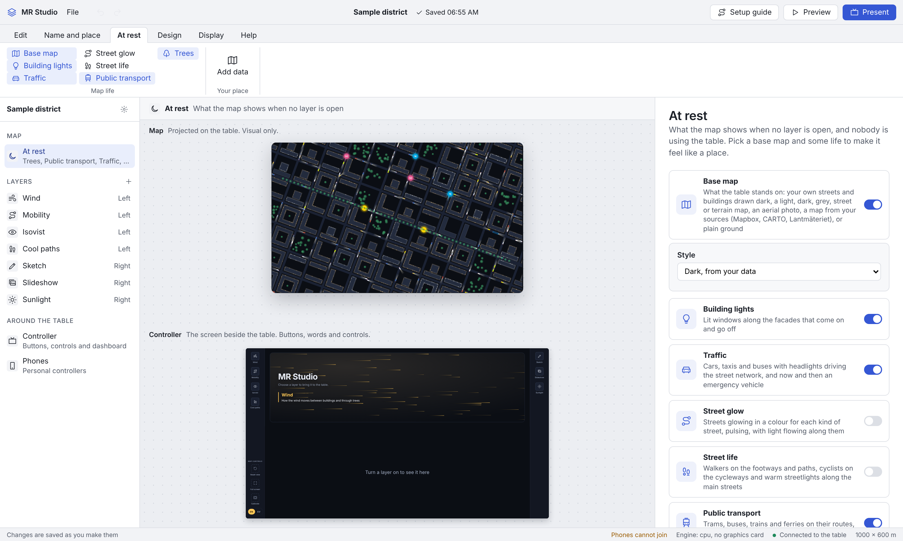

## 0.8.0 (2026-11-24)

### Breaking changes

- A table with "services" in its site.json opens only in this version or newer; update the app on every computer that runs it. (#278)

### New

#### Fetch everything from open data in one go (#310)

A new table's **Your place** step starts with **Fetch everything from open data**: buildings, streets, walking paths and trees from OpenStreetMap and the ground from free elevation, ticked and fetched together. OpenStreetMap is asked once for all of them, which is quicker and kinder to its shared servers than one request per dataset. One list shows how each one is doing, the editor reloads once at the end, and anything that failed has its own **Try again**. Datasets already on the table start unticked, so nothing is replaced unless you ask.

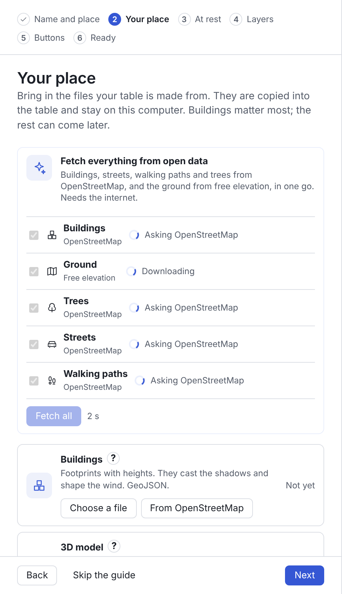

#### Models that run beside the table (#278)
A table can now start its own models, such as an energy optimiser in Python, every time it opens. It keeps them running, restarting any that stop, and its layers ask them for answers. Long runs show their progress on the controller. If a model is down or the table is offline, the table shows the last answer it got. `samples/service-example` has a small model and a layer that uses it.

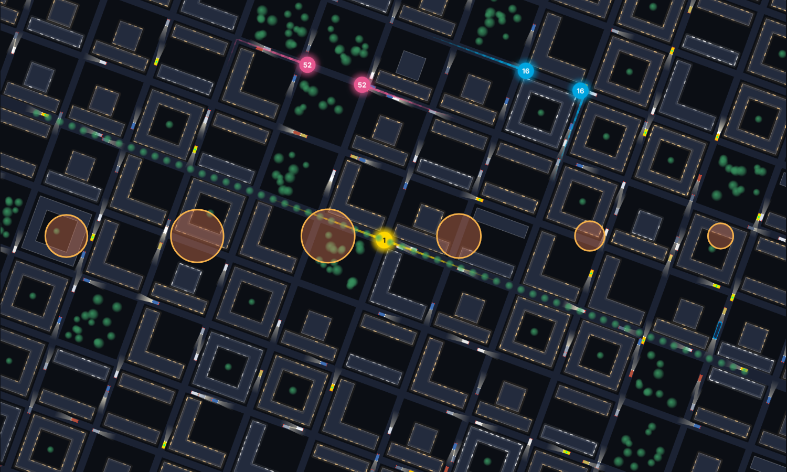

### Fixes

#### The sun glides through the day (#302)

Playing the sun study no longer jerks. The table now keeps its own clock while the day plays, so the sun, its glow and the shadows move a little every frame instead of jumping each time the time came back from the host. Shadows are drawn without stalling the frame, and on a slower graphics card they are drawn a little less often rather than slowing the whole table. The controller and the TV still follow the time a few times a second.

Sunset is calm now too. The day slows to a third of its speed near sunrise and sunset, when shadows race across the table, so the golden hour gets its time. Long low shadows are drawn a little softer, and after sunset the table fades into night instead of switching back to the bright map.

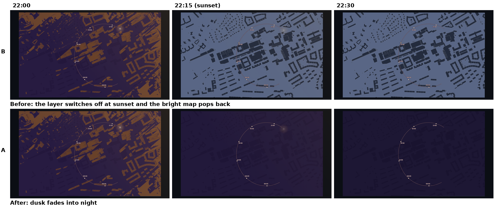

## 0.7.0 (2026-11-24)

### New

#### A Media tab, and lists instead of names to type (#306)

The editor's ribbon has a **Media** tab with everything the table can show: map data, drawings, pictures, video, sounds, the 3D model and the online sources of this computer. Each has a preview and says which layers use it, and goes on the table with one click. **Add media** takes any file, and the files a table is made from can be brought in or replaced here as in the guide's Your place.

Settings that named a dataset, a file, a column or a WMS layer were boxes to type the exact name in. They are now lists to pick from, with type-ahead: a name that is not in the table is refused, so a typo can no longer leave a layer empty.

#### Try a custom layer with test data (#308)

No data yet? The New custom layer window now offers random points, places, lines or areas, made up on the spot inside your table with columns to colour, size and animate by. Random places come with a day of activity, flows and links and start with a place motion, so you can switch through every place motion, cultural gravity included, straight away.

## 0.6.0 (2026-11-24)

### New

#### Artworks that draw themselves, a magnifier and X-ray, and a reveal line (#286, #287, #288, #289)

The Lindholmen artwork is now made of parts any table can use. A plan drawing can trace its lines in, turn to colour and grow viewpoints one at a time, placed on the map by its corners, and shows on the controller too. Pointing at a part of it lights it.

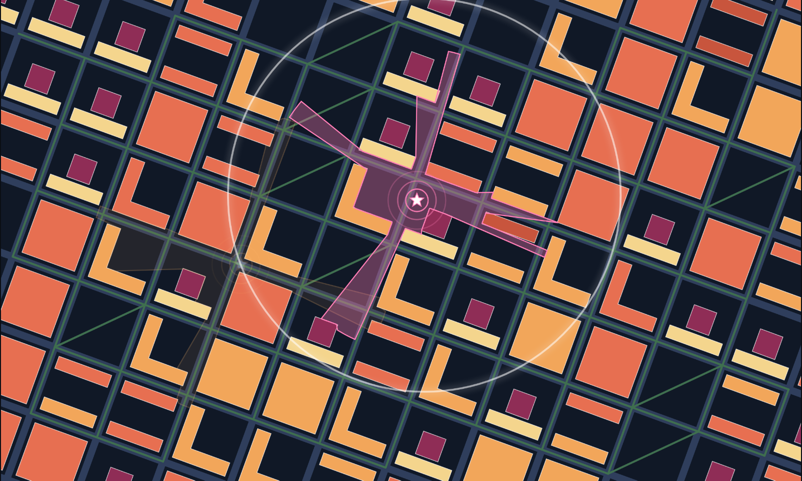

The new Magnifier is a glass people move with the mouse, the controller or a phone. It shows the table larger, or, as an X-ray, the layers placed inside it, such as pipes and tunnels under the street.

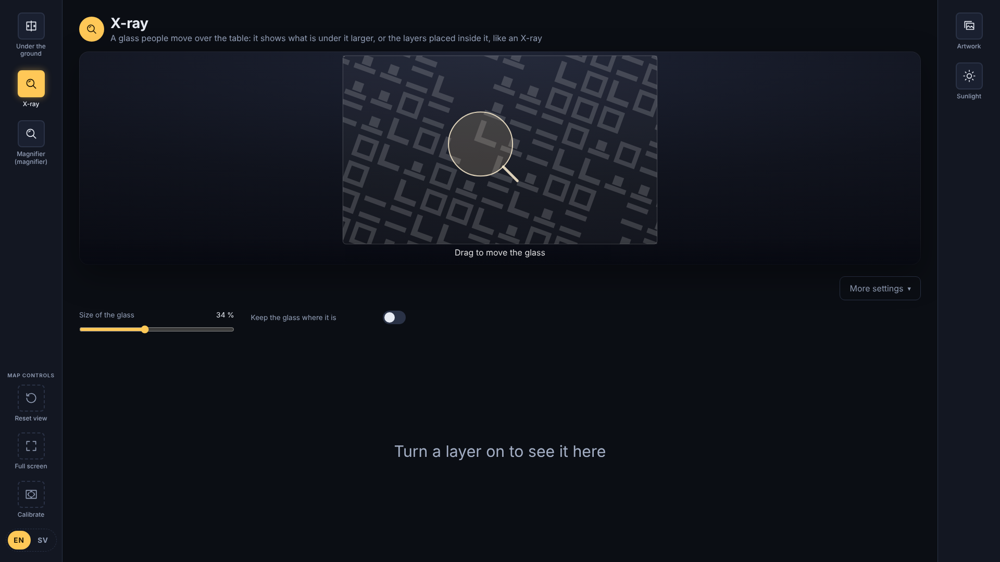

The new Reveal line is a line people drag across the table, with the layers inside it showing on one side.

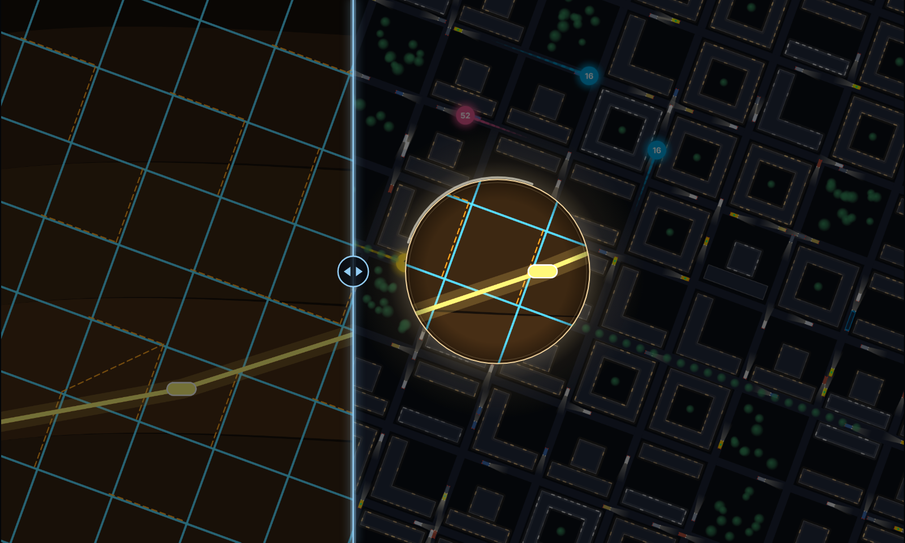

Large parts of the map can now start an animation when a pointer rests over them, ready for the camera's hands later.

#### Plans that come to life part by part (#300)

A masterplan drawn with its parts named by what they are now animates each part the way the Chalmers demo's Campus Vision did. The boundary traces and its dashes march, the main axis grows from its middle, routes are drawn one after another, points pop in, nodes grow their rays and green spaces breathe. Phases numbered in their names are revealed in that order. There is a template drawing in the sample kit.

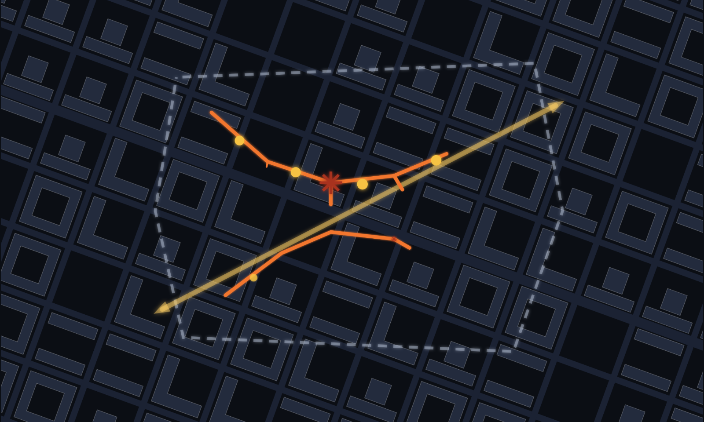

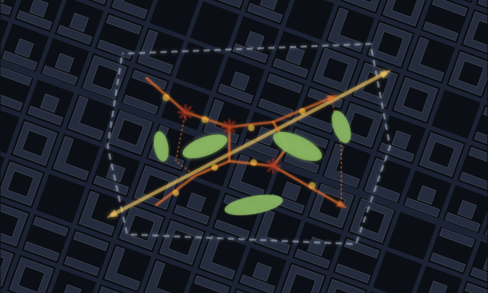

### Fixes

#### The + beside Layers opens a list of layers to add (#305)

In the editor, the **+** next to **Layers** on the left looked like it did nothing. It now opens a short list under it with every layer the table can add, then **Custom layer…** and **Add data…**. Picking one does the same as the ribbon's tool: a layer that needs data first takes you to bring it in, and adding a layer the table already has still asks first. Esc or a click elsewhere closes the list.

## 0.5.0 (2026-11-24)

### New

#### Opening a layer quiets the map at rest (#303)

When a layer is opened from the controller, the life on the map at rest steps aside: traffic, street life, public transport, building lights and trees pause, and the base map stays underneath for context. Close the layer and everything at rest comes back, as Street Life did in the Chalmers demo. The slideshow and picture layers still hide the base map too. Sketch and other tools kept alongside don't count as an open layer.

#### Your own layers, with code, in the installed app (#277)
A table can now carry layers its team wrote, with their own drawing on the table and their own panels on the controller, without changing MR Studio. `mrstudio layer new` makes a working layer in the site's `layers/` folder, `mrstudio layer build` gets it ready, and the app loads it next to the built-in layers. Developers write against the same SDK as the core layers. The table's computer runs the built layer and needs no extra tools.

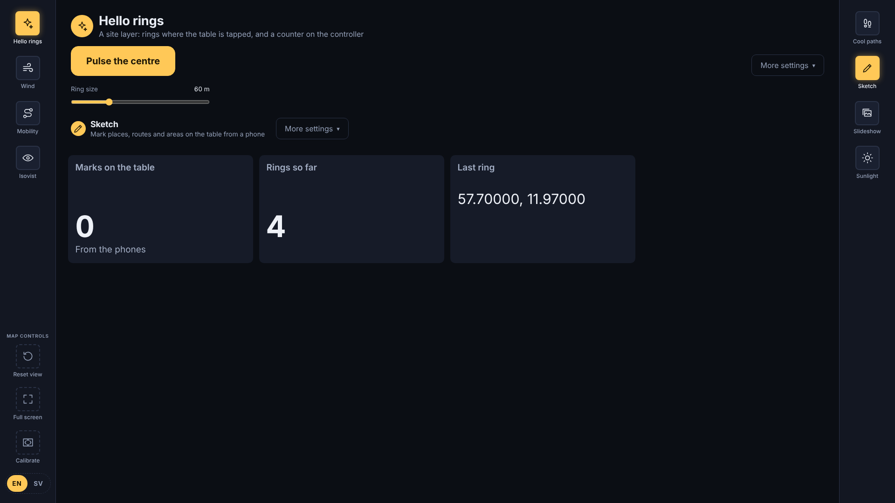

## 0.4.2 (2026-11-24)

### Fixes

#### Every table shows its own buildings and trees (#222)

In the desktop app, a table could open with its streets and traffic but no buildings, trees or building lights. All tables use the same addresses for their files, and the app's window kept copies from an earlier table. A table whose files were older than those copies, such as one copied from a repository, was given the earlier table's buildings and trees, which lay somewhere else. The app now always fetches a table's files fresh, and it checks its own pages on every load, so an updated app never shows an earlier version's page.

## 0.4.1 (2026-11-24)

### Fixes

#### Esc always leaves Present (#295)

Esc takes you out of a full-screen Present, back to the editor, also when the table was opened without the editor. The full-screen screens now get the keyboard straight away, and the table shows a "Back to the editor" button when the pointer goes to its top edge. A table that starts by itself with the computer still ignores Esc.

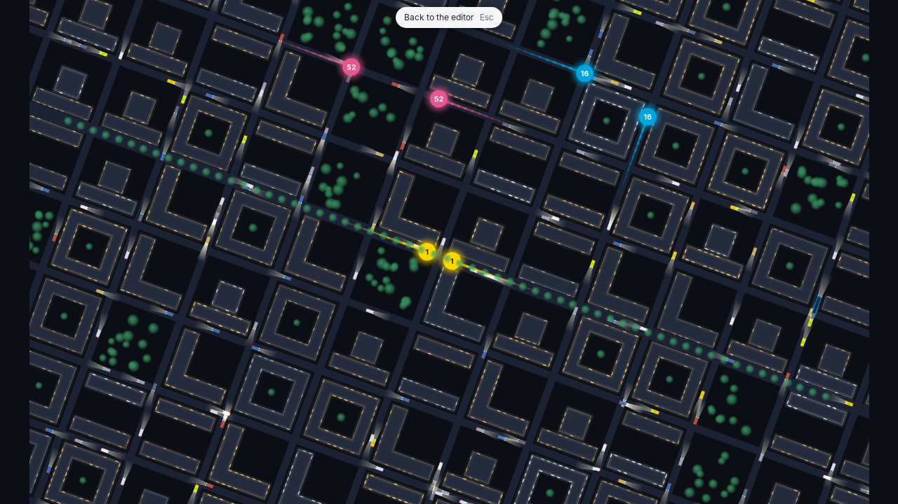

## 0.4.0 (2026-11-24)

### New

#### Phones join on eduroam and mobile data (#275)

Visitors scan the QR code as before, from any network: the code opens a small join page on GitHub Pages that connects to the table over WebRTC, with no router or server of our own. The phone page itself still comes from the table, so it always matches. Join page link v1.

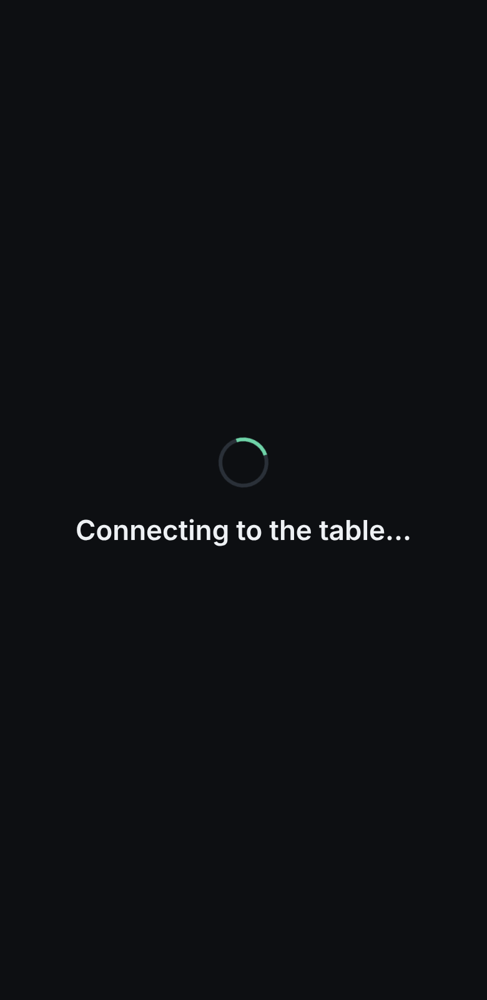

## 0.3.0 (2026-11-24)

### New

#### A Help page for every layer, and what to do when something is wrong (#291)

Every layer now has its own page in the Help window. Each page says what the layer shows and what it is good for, and walks through setting it up step by step. It also lists what data the layer needs, every setting with its range and starting value, and some tips. The settings come from the layer itself, so the page always matches the app. In the editor, **How to use it** beside a layer's settings opens its page.

A new page, **When something is wrong**, goes by what you see. It covers a projection that doesn't line up, a window on the wrong screen, an empty layer, phones that can't join, a slow table, missing map pictures, keys, the first start on a Mac or Windows, and updates.

## 0.2.1 (2026-11-24)

### Fixes

#### Present fills the screens you chose (#270)

Present now opens the table and the controller full screen on the screens picked in the Display tab, also on a Mac with a Retina laptop beside a projector or TV, instead of leaving windows half on one screen. A window that ends up off its screen is put back by itself.

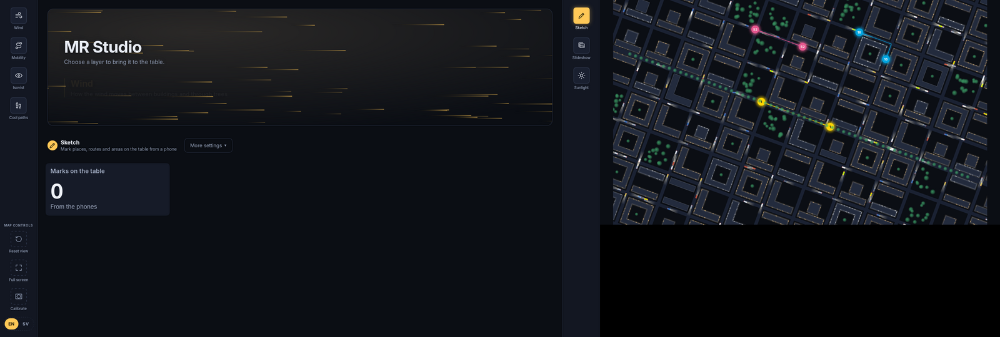

## 0.2.0 (2026-11-24)

### Breaking changes

- Tables saved by this version use site format 3 and do not open in older versions of the app; older tables are upgraded when opened and the original is kept beside them as site.format-2.json. Update the app on every computer that opens a table. (#70, #69)

### New

#### Layers with their own ids, items and sequences (#70, #69)

Every layer in a table has its own id, a layer can hold items that show only while it is open, a slideshow can be a sequence of layers, and custom layers are saved in the table. The editor can also hide some of a layer's controls from visitors.

#### Street life at rest (#195)

Walkers on the footways, cyclists on the cycleways, warm streetlights, glowing streets, taxis, buses and now and then an emergency vehicle, while nobody touches the controller.

#### Stormwater, live (#189)

Rain runs off roofs and slopes, gathers in streams and pools in low spots as the storm goes on, computed live on the graphics card.

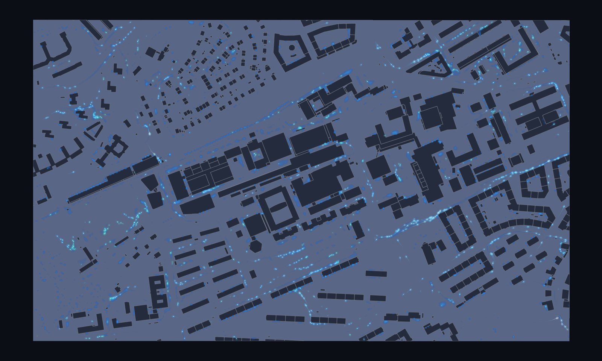

#### Isovist with Street View and a green soundscape (#190, #82)

Stand anywhere on the table and see what a person there can see, how green that view is, the Street View picture of the spot, and hear how it sounds.

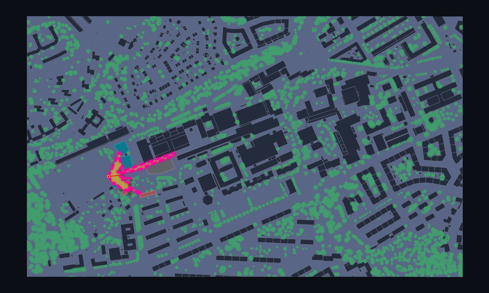

#### Cool paths by thermal comfort (#196)

Cool paths routes the walk with the least heat stress (PET) beside the shortest one, as in the Chalmers demo.

#### Sun study: three seasons and sun at a spot (#252, #256, #121)

Sunlight shows winter, equinox and summer side by side, and tells how many hours of sun one spot gets. Fixed: sun data that went stale after a fast toggle.

#### Guided tours from the guide's phone (#98)

A slideshow of layers gets presenter notes on each step. The guide moves through it from their phone and reads the notes there; visitors never see them.

#### Swedish and English for visitors (#80)

Visitors switch the controller and their phones between Swedish and English. The table's own words are translated under Table settings.

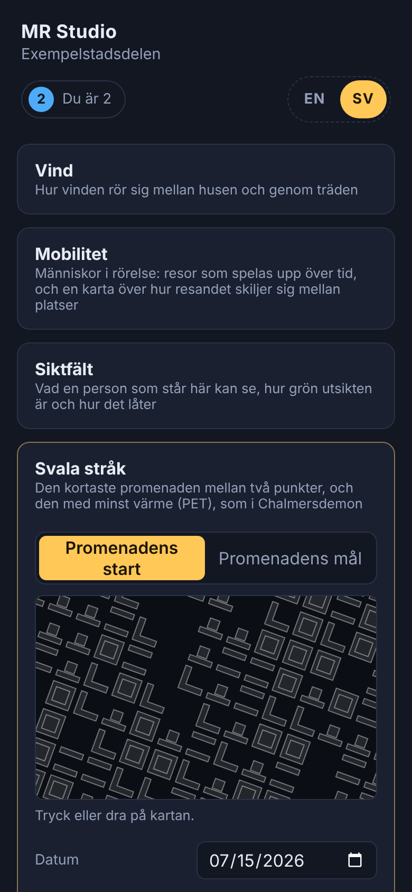

#### Masterplan, phase by phase (#193)

Import a plan drawing (SVG or a picture) and reveal it on the table one phase at a time.

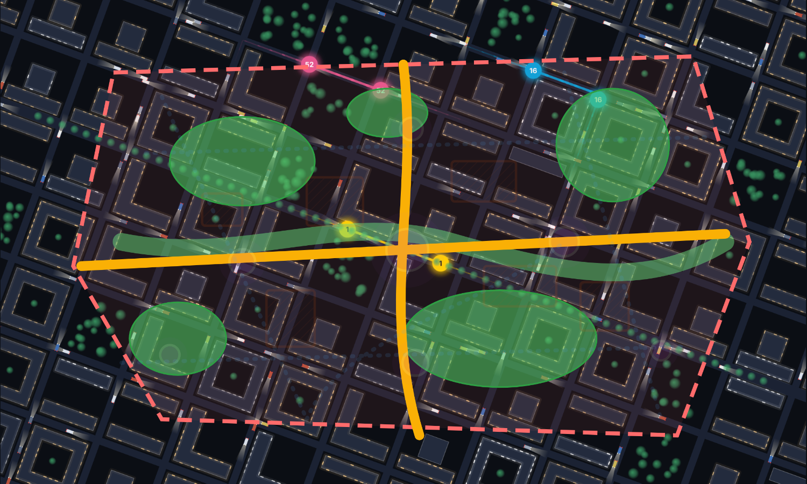

#### Video walk (#194)

A walk filmed on site plays on the controller while the walker moves along their path on the table.

#### Undo, redo and a History panel (#72, #57)

Every change to a table is kept. Undo and redo work across the editor, and the History panel goes back to any earlier state.

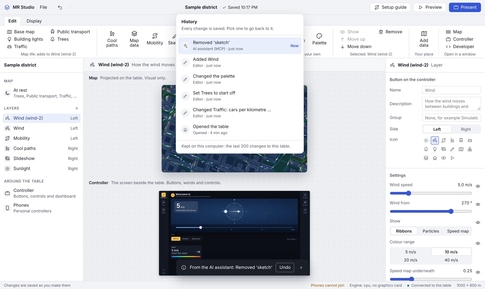

#### Phones join from any network (#89)

Visitors' phones join through the relay when they are not on the table's Wi-Fi.

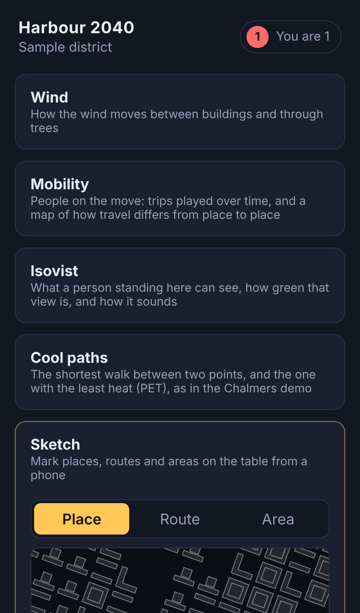

#### Ribbons in the projector's blank space (#78)

At-a-glance strips beside the model, on any side, sized from the table and the projector, with the visitors' side first.

#### More base maps (#37, #42)

Free map styles, maps from your Sources (Mapbox, CARTO, Lantmäteriet, WMS, ArcGIS), black and white, brightness, an offline tile store and the map's credit.

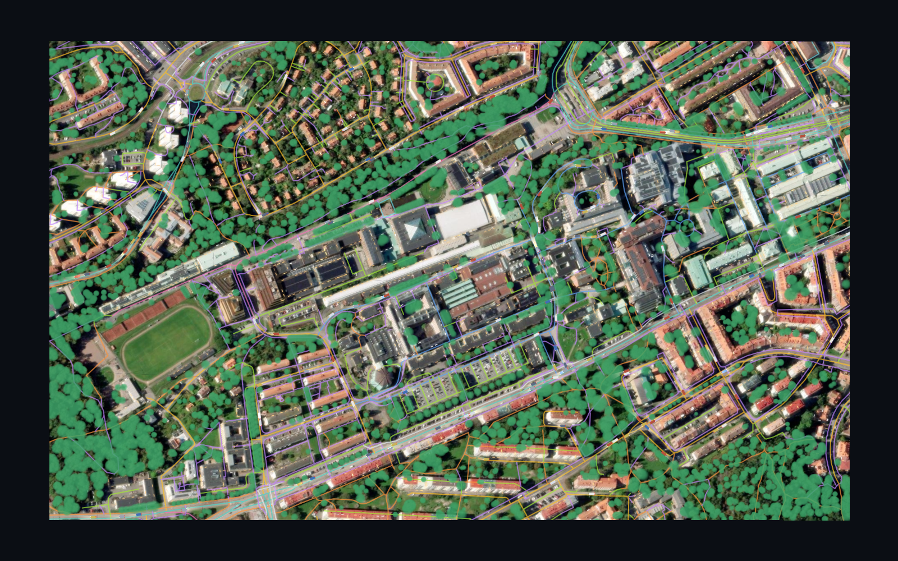

#### Run a table unattended (#79)

The engine restarts itself, a watchdog keeps the windows up, an operator log records what happened, the table can restart every night and the app can start at login.

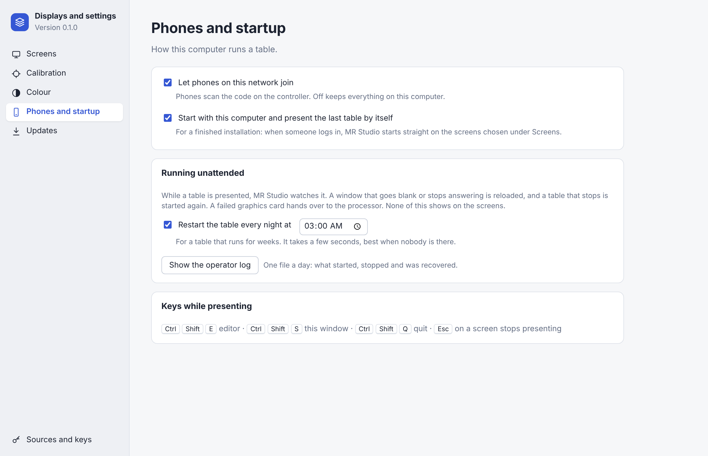

#### One file per table (#85)

Export a table as one .mrstable file and open it on another computer. Keys never travel in the file.

#### Table settings and app settings apart (#73)

What belongs to the table (name, time zone, welcome line, languages) travels with it; screens, colour and keys stay with the computer.

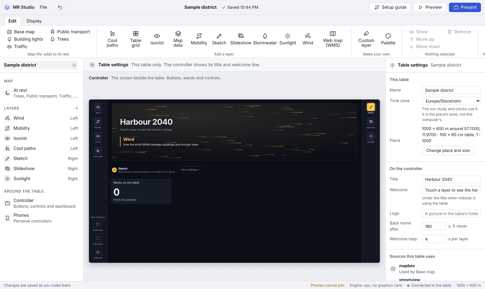

#### The controller's home and stage (#74, #76, #198)

The home screen loops through the layers by itself and resets after a quiet spell. Each layer's stage has a hero, a legend and large actions, and Map controls and Credits are one tap away.

#### Table grid (#191)

A glowing grid on the model's tile seams, to check that the projection lines up.

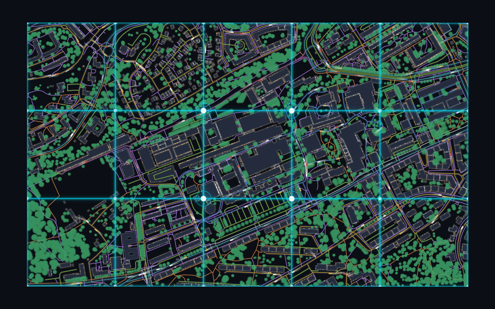

#### Shadow trails over the day (#265)

Sunlight draws where the shadows travel through the day, so one picture shows which places stay in the sun.

#### Pictures and videos on the table, and slide transitions (#197, #43)

A picture or video of the site can cover the whole table, on its own or as a slide, and slides move on with a cut, a fade or a dip to black.

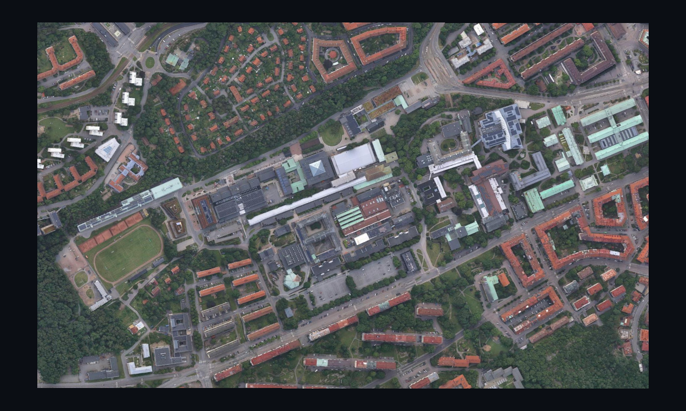

#### What's new, on Home (#267, #268, #258)

When a newer MR Studio is out, Home says so and shows each new feature with its picture. Download gets the installer for this computer. After an update, Home shows what the new version brought, once. Every merge is now a numbered release with these notes, and the build stamp (version, commit, date) shows under the name.

#### The MCP server knows what is new (#269)

The MCP server now offers the recent building blocks (marks, place motions, palette, ribbons, sound, languages, guided tours, thermal comfort, isovist and more), a whats_new tool that reads the changelog, and prompts that cover tours, languages and ribbons. Each release carries the matching server as mrstudio-mcp.mjs, and a check keeps the docs and the server in step with what is built.

#### Help in the editor (#271)

A Help tab in the editor's ribbon opens a guide in its own window: step-by-step guides (make a table, set up layers, bring in data, slideshows and tours, the controller and phones, calibration, presenting, sharing) and every layer with a picture. It is built from the same docs as the repository, so it matches the version you run.

