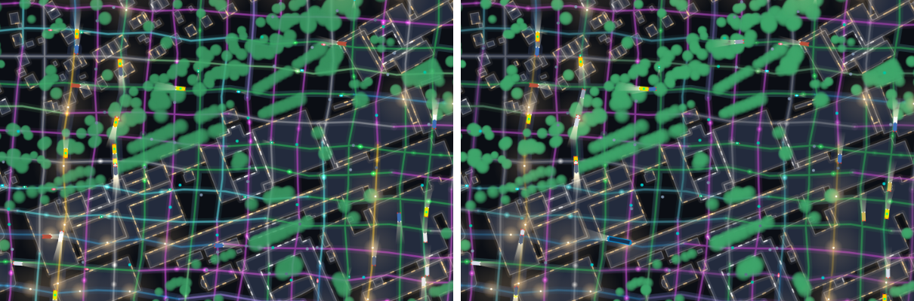

### The presented table draws far less each frame

On a Mac, the presented Chalmers table ran at about 4–5 frames a second (#596). Its ambient layers redrew whole pictures of the site many times a second, and WebKit draws those on the processor. Now each layer draws only what moves:
- Street glow draws its streets once and pulses them by fading.
- Trees redraw a third of their crowns at a time.
- Building lights draw their soft glow once.
- Cars, people and transit redraw up to 30 times a second.

The table looks the same. In a test on the same site, the layers' own drawing time per frame fell from about 245 ms to about 100 ms, and street glow fell from about 60 ms to about 12 ms.

