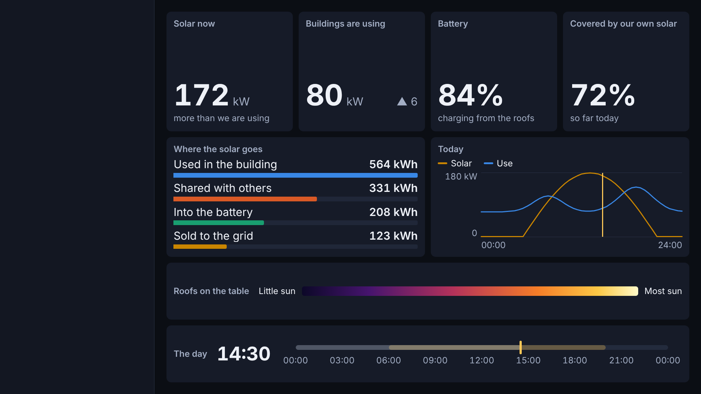
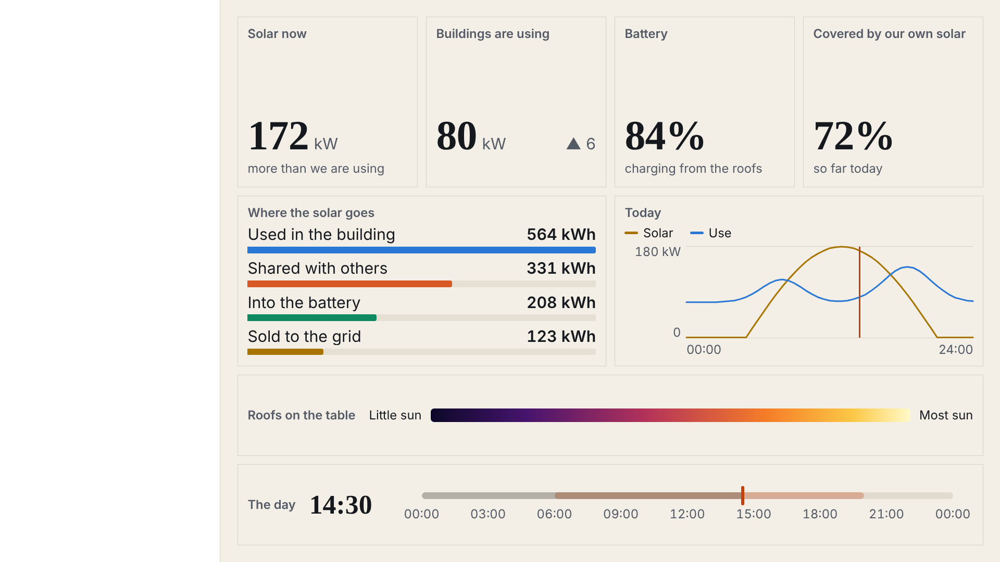

# The TV dashboard: design system

Status: v0.1. The rules here are enforced by `@mrstudio/dashboard` (`packages/dashboard`).
The JSON shapes are in [contracts/dashboard.md](contracts/dashboard.md).



## Why a system

The TV in a studio is read by a group standing two to five metres away, while they talk and look at the table.
Nobody studies it. A visitor glances up, takes in one or two things and looks back down.

The dashboards in the current app grew one layer at a time. Each layer positioned its own elements with its own pixel sizes, so the KPI bar, the timeline and the legends used text from 10 to 19 px, sat on top of each other by `z-index`, and every new feature added a little more to the same screen.
Nothing stopped that, because nothing counted it.

The 2.0 dashboard starts from the opposite end: **the screen has a fixed capacity, every panel spends some of it, and the system refuses what does not fit.**
Density is not a matter of taste or review. It is a number the code checks.

## Principles

1. **One grid.** Every panel sits on the same 12 by 6 grid. Nothing floats, overlaps or is positioned by hand in pixels.
2. **A closed set of sizes.** A panel is one of eight sizes. There are no custom spans, so panels always line up and a layout is always a tiling.
3. **Reading is budgeted.** Each panel size holds a fixed number of *reads*. Each widget states what it costs. The screen has a total. Over budget is an error, not a warning.
4. **Nothing shrinks.** Text has a minimum size tied to the screen. When there is too much, the answer is another page or a larger panel, never smaller type, tighter spacing or a scroll bar. The one give is a headline number: beside a long unit it may step down to the small number size, never below the label size, so it stays inside its panel (#681).
5. **One widget per panel.** Panels do not nest. Nesting is how a "small addition" hides inside an existing box.
6. **Panels are data.** A panel is a JSON object: a widget type, a size, props and bindings. Layers do not write layout code, and a visual editor can produce the same JSON later.
7. **Rules are core, looks are per site.** A site can change colours, typefaces, corners and the panel treatment. It cannot change the grid, the sizes, the type scale or the budgets.
8. **Live data obeys the same limits.** A bound value that is too long is cut, and a bound list that is too long loses its tail, so data arriving at run time cannot break a layout that passed the checks.
9. **Nothing scrolls and nothing spills (#681).** What a panel holds stays inside its box. Text cut short with an ellipsis is drawn to fit; anything else that reaches past the panel's edge is a fault in the panel, measured on screen and reported, never something to scroll to.

## The screen

```
┌──────────┬──────────────────────────────────────────────────────────┐
│          │  1   2   3   4   5   6   7   8   9   10  11  12           │
│  rail    │ ┌───────────┐┌───────────┐┌───────────┐┌───────────┐  1  │
│          │ │ tile      ││ tile      ││ tile      ││ tile      │  2  │
│ controls │ └───────────┘└───────────┘└───────────┘└───────────┘     │
│ generated│ ┌────────────────────────┐┌────────────────────────┐  3  │
│ from the │ │ wide                   ││ wide                   │  4  │
│ layer    │ └────────────────────────┘└────────────────────────┘     │
│ manifests│ ┌──────────────────────────────────────────────────┐  5  │
│          │ └──────────────────────────────────────────────────┘     │
│          │ ┌──────────────────────────────────────────────────┐  6  │
│          │ │ band (the timeline docks at the bottom)          │     │
└──────────┴─└──────────────────────────────────────────────────┘─────┘
```

The TV has two regions.

- **The rail** holds the controls generated from the layer manifests. On the controller screen it is two columns of layer buttons, one each side of the canvas; an open layer shows its controls under its button. `tv.rail` picks the side a button defaults to, or `none` for a TV that only displays.
- **The canvas** is everything else and holds the panels. It is always 12 columns by 6 rows, with a margin of 3 units and a gap of 1.5 units.

A **unit** is 1% of the canvas height. Every length in the dashboard is a multiple of it, so a layout is the same picture on a 1080p and a 4K screen, and text keeps its size relative to the screen.
(On a canvas narrower than 4:3 the unit follows the width instead, so a small window still shows a correct miniature.)

## Panel sizes

| Size | Columns × rows | Reads | Meant for |
| --- | --- | --- | --- |
| `chip` | 2 × 1 | 1 | One short value |
| `tile` | 3 × 2 | 3 | One headline number with context |
| `wide` | 6 × 2 | 5 | A small comparison or a short trend |
| `tall` | 3 × 4 | 6 | A ranked list |
| `block` | 6 × 4 | 8 | One chart |
| `hero` | 9 × 4 | 10 | The one chart the page is about |
| `band` | 12 × 1 | 3 | A timeline or a colour key across the screen |
| `strip` | 12 × 2 | 6 | A trend across the screen |

Budgets grow more slowly than area on purpose. A `hero` is 18 times the area of a `chip` but holds 10 times the reads: a bigger panel is for a bigger picture, not for more items.

## The density budget

A **read** is one thing a visitor has to take in separately: a number with its label, one bar, one line in a chart, a chart's scale, a line of context.
Titles are free, because every panel must have one.

| Level | Limit | What happens over the limit |
| --- | --- | --- |
| Text | Title 28 characters, label 20, caption 40, unit 6, value 8, note 128 | Literal: refused. Live: cut with an ellipsis |
| Widget | Bars 6 (4 in `wide`), lines 3 (2 in `wide`), points per line 96 | Literal: refused. Live: the tail is dropped |
| Panel | The reads of its size (table above) | Refused. The message says to remove something or use a larger size |
| Screen | 24 reads and 8 panels at once | Automatic layout: the rest go to another page. Hand-made page: refused |

Twenty-four reads is a deliberate ceiling: about three things from each of eight panels, or one rich chart and a row of headline numbers.
The cells alone would allow more (twelve tiles fit the grid), which is exactly the kind of screen this system exists to prevent.

When panels need more than one page, pages take turns (12 seconds each by default, `tv.rotate_s`), with dots showing which page is up.
Panels on a second page are still full size.

### Where the rules are checked

- **In tests and CI.** `validateLayerPanels`, `validatePage` and `validateTheme` are pure functions. The dashboard tests run them over every panel and theme in the repo.
- **On the TV.** The canvas checks every panel before mounting it. A panel that breaks a rule is not shown; in dev mode the reason is listed on the canvas, on the TV it goes to the console.
- **In the page.** Grid tracks never grow, panels clip their content, there is no scrolling, and widgets only use the type tokens. Even a `custom` panel cannot push its neighbours.
- **On screen (#681).** After each change the canvas measures the panels on show and reports any whose content spills out of its box: in the console and `issues` (rule `overflow`), outlined in dev mode, in the Developer window's Problems, and in the editor's status bar while the live controller shows it.
- **In CI, in every engine (#681).** `pnpm --filter @mrstudio/dashboard fit` draws every core widget at every size it takes, with its example props and with the worst the rules allow (`worstCasePanel`: every text at its limit in long Swedish words, lists as long as the size takes), on a 1080p and a 720p screen, and fails on any spill. It runs in Chromium, and in WebKit and Edge in the engine smoke jobs.
- **In a future editor.** The same functions decide whether a drop is allowed and what the budget meter shows.

## Widgets

A widget is a kind of panel content. Each has a schema for its props, the sizes it comes in, and its cost.

| Widget | Shows | Sizes | Cost in reads |
| --- | --- | --- | --- |
| `stat` | One headline number with a unit, optionally a line of context and a change | chip, tile, wide | 1, +1 for context, +1 for a change |
| `bars` | Up to six labelled bars on one scale | wide, tall, block | 1 per bar |
| `gauge` | One value against its range as a half circle that fills, with a tick for a target (#356) | chip, tile | 1, +1 for a target |
| `list` | A short ranked list of names and numbers, highest first, lowest first or as given (#356) | tile (3 rows), wide (4), tall (6) | 1 per row |
| `donut` | Shares of a whole as a ring of up to five parts, a headline in the middle and a key with each share (#356) | tile (3 parts), wide (4), block (5) | 1 per part, +1 for the middle |
| `media` | A picture or a silent looping video from the table folder (View › Media library), which can change with a published value (#356) | tile, wide, tall, block, hero | 1, +1 for a caption |
| `legend` | A layer's legend: what the colours on the table mean, from what the layer publishes, else its layer.json legend, else rows given here (#356) | tile (3 rows), wide, tall, band (5 in a row) | 1 per row |
| `compare` | Two or three scenarios side by side, one figure each and the change from the first; a card not worked out yet says so (#281) | chip (the last change only), wide, block | 1 per scenario, +1 for the change; chip 1 |
| `balance` | Where something came from and went to, as two bands split by share, with one headline such as self-sufficiency (#281) | chip (the headline only), wide, block | wide: 1 + 1 per band; block: 1 + 1 per part; chip 1 |
| `control` | One of the layer's controls or named actions, drawn from its definition in layer.json: a slider (range), a toggle, side-by-side choices (up to three, else a list) or a button (action). It changes the layer as the controller's own control does; on the table's ribbon it only shows the value (#354) | chip, tile, wide | chip 1, otherwise 2 |
| `map` | The site's map: chosen datasets in the data colours, the table's outline, shapes a layer publishes on top, and a tap that picks one of the layer's entities or sends a point to one of its tools (#355) | wide, tall, block, hero | 1, +1 per dataset, +1 for shapes, +1 for the line under it |
| `series` | Up to three lines over time on one scale, optional marker for now | wide, block, hero, strip | 1 per line, +1 for the scale |
| `ramp` | The colour key of the field on the table and what its ends mean | tile, band | 2 |
| `timeline` | A span of hours, the part played, daylight shaded, a marker on now | band | 2 |
| `text` | One or two sentences | tile, wide | 2 |
| `custom` | Whatever the layer's own code draws | all | Declared by the layer, 1 to 10 |

Things that are deliberately missing: tables, pie charts, a second y-axis, free HTML and icons-as-data.
A table on a TV is a document, and nobody reads documents across a room.

`custom` is the escape hatch for what no widget covers, such as a map inset. The sunlight layer's curve of the sun's height over the day is one.
It still gets a title, a fixed size and a declared cost, and it is clipped to its panel.
If two layers need the same custom panel, that is the signal to make it a widget.

### What a chip cannot do

The budget does real work even in small cases.
A `stat` with a caption costs 2 reads, and a chip holds 1, so "a number with a caption in a chip" is refused: a caption needs a tile.
Nobody has to remember that as a guideline.

## Typography

Four sizes, set in units, and no others. Widgets cannot use a size that is not in this table.

| Token | Size | At 1080p | Used for |
| --- | --- | --- | --- |
| `label` | 2.2 | 24 px | Panel titles, captions, axis and tick labels. The smallest text allowed |
| `body` | 2.8 | 30 px | Bar labels and values, notes, units |
| `number-s` | 4.8 | 52 px | The value in a chip, the clock on the timeline |
| `number` | 7.4 | 80 px | The headline number in a tile |

The floor of 24 px on a 1080p screen is a rule of thumb for reading at three to five metres, not a measured result; it should be checked on the real TV in the Chalmers studio and can be raised in one place (`dashboard.css`).
For comparison, the current dashboards use 10 to 14 px for most labels.

Numbers use tabular figures so they do not jitter as they change.
Numbers are formatted by the system, never by the layer: at most about six characters, decimals give way before the integer part, and values above 10,000 become `12.3K`.
Titles say what the number is in plain words ("Buildings are using"), not the name of a variable.

## Colour

Colour has three jobs, and a token set for each.

| Job | Tokens | Rule |
| --- | --- | --- |
| Surfaces and text | `color.background`, `color.panel`, `color.line`, `color.text`, `color.muted` | Text is always a text token. It never wears a data colour |
| Emphasis | `color.accent`, `color.accent-ink` | Only for "now" and "active": the marker on a timeline, the current page |
| Data | `data.1` to `data.6` | Identity of a series or a bar. Widgets refer to slots, never to hex values |
| Status | `color.good`, `color.warn`, `color.bad` | Reserved for state, always with a word or a glyph |

Six data colours is the cap. A seventh category folds into "other".
The default data colours are a validated set: they keep their distance from each other for viewers with colour-vision deficiency and reach 3:1 against the panel.
A change is shown with an arrow as well as a number, so direction is never carried by colour alone.
Fields on the table keep their own ramps (`colormaps` in the SDK); the `ramp` widget shows the same ramp, so the TV and the table always agree.

## How layers contribute panels

A layer lists its panels in `layer.json`. It does not place them, and it needs no TV code.

```jsonc
"panels": [
  { "id": "time", "widget": "stat", "size": "tile", "title": "Time on the table",
    "visibleWhen": { "mode": "instant" },
    "props": { "value": { "bind": "params.hour" }, "format": "hour", "caption": { "bind": "shared.sun" } } },
  { "id": "day", "widget": "timeline", "size": "band", "title": "The day",
    "props": { "now": { "bind": "params.hour" } } }
]
```

- `{ "bind": "params.x" }` reads one of the layer's controls. `{ "bind": "shared.x" }` reads a value the layer's table code published with `ctx.publish`. `{ "bind": "site.x" }` reads the site.
- `visibleWhen` works as it does for controls.
- `priority` decides who gets the first page when several layers are on.
- The layer computes and words its values in its table code and publishes them. Panels only display.

While a layer is on, its panels are on the canvas. The automatic layout places panels in priority order, first fit in reading order; `band` and `strip` dock at the bottom.
`packages/layers/sunlight` is the reference.

## How sites restyle, and what they cannot change

A site sets style tokens in `site.json`:

```jsonc
"tv": {
  "rail": "left",
  "theme": {
    "color.background": "#f3efe6", "color.panel": "#ffffff", "color.text": "#15181d",
    "color.accent": "#c2410c", "font.number": "Georgia, serif",
    "shape.radius": "none", "panel.style": "outlined"
  }
}
```

| A site may change | A site may not change |
| --- | --- |
| Every colour token, including the six data colours | The grid, margins and gaps |
| Typefaces: `font.text`, `font.number` | The type scale and the minimum text size |
| Corners: `shape.radius` (none, small, medium, large) | Panel sizes and their budgets |
| Panel treatment: `panel.style` (filled, outlined, glass, plain); layer buttons: `rail.look` (tiles, bare); chrome: `density` (comfortable, minimal) | Text limits and the screen budget |
| Where the rail sits, and its own hand-made pages | What a widget costs |

The style tokens have rules of their own, because a theme can make a screen unreadable as surely as a crowded layout can:
text needs a contrast of 7:1 against the background and the panel, secondary text 4.5:1, data, accent and status colours 3:1.
A theme that fails falls back to the default colours as a set, and the reason is reported.
A token that is not in the list, such as a font size, is refused by name.



A site can also replace the automatic layout with hand-made pages (`tv.pages`), placing each panel with `at: { col, row }`.
Those pages pass the same checks: inside the grid, no overlaps, within the screen's budget.
`packages/dashboard/examples/` has a page modelled on the current energy dashboard (headline tiles, where the solar goes, the day's curve, the timeline) and a light theme.

## Ready for a visual editor

The editor is not built, but everything it needs is plain data today.

- **A page is a JSON document**: a list of panels with a widget, a size, a position and props. Saving a layout is writing `tv.pages`.
- **The widget registry describes itself**: `registry.describe()` returns each widget's name, description, sizes and prop schema. Every prop has a kind (`text`, `number`, `value`, `enum`, `slot`, `colormap`, `list`, ...), a label and whether it can be bound, which is enough to draw the palette and a form per widget.
- **The rules are functions**: `validatePanel` and `validatePage` return a list of issues with a path, a rule and a sentence. An editor calls them on every change, shows a budget meter from `panelReads`, snaps drops to grid cells and greys out sizes a widget does not come in.
- **Bindings are strings** (`shared.solar`), so a picker can list what a layer publishes.

What an editor still needs from elsewhere: a place for the host to save a site's `tv` settings, and a list of the values each layer publishes (today they are only known at run time).

## Looking at it

```
pnpm --filter @mrstudio/dashboard gallery     # then open http://localhost:5175
```

`?view=energy` is the hand-made example page, `?view=auto` shows two layers laid out automatically across two pages, `?view=refused` shows what dev mode reports for panels and themes that break the rules, `&theme=light` applies the example site theme and `&grid` draws the columns.

## Open questions

- The rail's controls still use the runtime's own small type. They are for the person standing at the TV, not for the room, but they should move onto the same tokens.
- The minimum text size and the screen budget of 24 are first values. Both are single constants and should be tuned on the real screen.
- Pages rotate on a timer. A phone or the rail could also turn pages.
