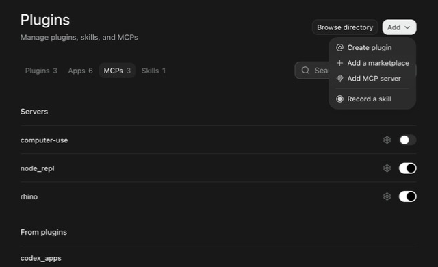
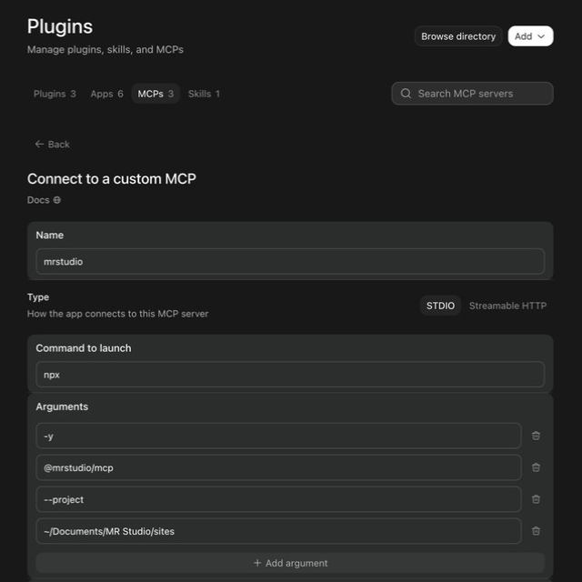
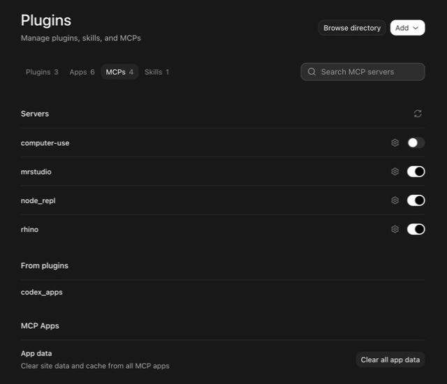

# MR Studio MCP server

`@mrstudio/mcp` lets a team build an MR Studio project by talking to their own LLM (Claude, or any client that speaks the Model Context Protocol).
The model gets tools that read the core's layers, building blocks and contracts, create and edit a site package with every change validated, and turn ideas the core cannot serve yet into requests for this repository.

It follows the distribution model in [ARCHITECTURE.md](ARCHITECTURE.md): a team keeps only its site, never a fork.
The server writes `site.json`, never layer code. When a project needs a new layer, block, kernel or site setting, the server drafts a module request (an issue on `snjsomnath/mr-studio`) so it is built once, in the core, for everyone.

## What it offers

**Tools**

| Tool | Does |
| --- | --- |
| `overview` | What MR Studio is, the core version, the layers, kernels and blocks it has, and the workflow |
| `read_doc` | Architecture, roadmap, the changelog and every contract, verbatim |
| `whats_new` | What changed in the core, newest version first, from `CHANGELOG.md`, plus notes merged but not yet released; `since` limits it to versions newer than a team's |
| `list_layers`, `describe_layer` | Core (and site) layers with their controls, tools, data needs and panels; planned roadmap layers |
| `find_capabilities` | Everything MR Studio can and cannot do for a goal in plain words: layers, building blocks, kernels, site features, planned work and constraints, ranked, each with why it matched, its status from the code (`available`, `needs_setup`, `planned`, `unsupported`), what it needs, what the table, controller and phones do, what it pairs with and the files that prove it. With `site`, requirements say whether that site meets them |
| `describe_capability` | One capability in full: purpose, questions it answers, requirements, surfaces, limits, example sites, evidence, related issues, and a layer's controls |
| `assess_experience` | Checks a whole experience plan (title, goal, audience, steps with what the table shows, the controller says, phones do and the guide's notes; layers at rest; other needs) against the catalogue: per step the layer that serves it and why, alternatives, setup still needed, param problems, a constraint it runs into, and gaps with the kind of development request each needs. Verdict `buildable`, `buildable_with_setup`, `partly_buildable` or `needs_development`. Writes nothing |
| `build_experience` | Builds the parts of a plan that exist in one validated change: a layer per step (reusing instances), items inside them, layers at rest, and for two or more steps a guided sequence (a slideshow named after the plan) with titles, controller text and notes. Skipped steps and gaps are listed, never written |
| `list_building_blocks` | Older name, kept for this release only: visual, data, interaction and TV primitives, each marked built or planned from the code itself (`find_capabilities` with `kind` gives the same with evidence) |
| `create_site` | A new site package: `site.json`, `data/`, `requests/`, README, `.gitignore` |
| `get_site`, `update_site` | Read a site with effective params; change settings (place, table, scene sources, basemap, branding, tv) |
| `add_layer`, `set_layer`, `move_layer`, `remove_layer` | Compose the scene by instance id: layers, items inside a layer (`parent`), and buttons with groups; params are checked against the layer's controls with the host's rules |
| `set_steps` | How Next moves through a layer, and a slideshow's sequence of layers, with presenter `notes` per step for the guide's phone |
| `save_custom_layer` | Save or remove a custom layer: a recipe of data, look, motion and interaction blocks, used as `custom:<id>`. Blocks, props, colours, ramps, pictograms and icons are checked against the recipe player in `packages/sdk`, and the controller's legend is worked out from the looks and their data, as the editor does |
| `import_data` | Brings a dataset into the site with the editor's own Add data code (the `mrstudio data add` command): from a file (GeoJSON, CSV with lon and lat, zipped Shapefile, GeoTIFF for terrain), from OpenStreetMap for the table's area, or free elevation for the ground. Detects and reprojects the coordinate system and reports the count, what is on and off the table, issues and blockers. Checks only, unless `write`; then it saves into `data/` and points `site.json` at it |
| `export_starter_pack` | Makes a starter pack (#450, the `mrstudio starter-pack` command): the table's outline, tiles, buildings, streets, projection area and at-a-glance boxes as GeoJSON and a placed picture for QGIS, a layered SVG for Illustrator, PNG layers for Photoshop and a .pptx for PowerPoint, with a README of steps per program and how to bring the result back. The same as the editor's File, Export starter pack |
| `add_media`, `add_sound` | Copies a picture or video into `data/media/`, or a sound into `data/sounds/`, with the editor's checks, and returns the path to use |
| `list_site_files` | What is in the site's `data/` folder: datasets with feature counts, geometry, columns (number ranges, the values of a category) and bounds; pictures, video, sounds and models; and which `site.json` keys use each file |
| `sdk_reference` | What `@mrstudio/sdk` really exports, read from its source: functions, constants, classes, interfaces (with their members, such as `TableContext` with `ctx.publish`) and types, each with its doc comment and declaration; searchable in words or by name |
| `create_layer` | A site code layer, with `mrstudio layer new`: `layers/<id>/` with layer.json, src/index.ts, Swedish words, build script and README, running in the installed app without changing the core |
| `check_layer` | The layer rules for a site layer: layer.json (api, id, controls, panels within the TV's density budget, text lengths), every visible word in `locales/sv.json`, the code (no site coordinates, no talking to surfaces or the host directly, only `@mrstudio/sdk` from the core), the datasets, services and kernels it needs, and whether its build is current |
| `build_layer` | Bundles a site layer into `dist/index.js` with `mrstudio layer build` and returns the build errors, or the layer's checks when it builds. Needs Node 20+ for building only |
| `preview_layer` | Whether a site layer is built and in the scene, and the dev view (`/dev`) to see it with its controls and the TV dashboard |
| `add_service` | Declares an outside compute service in `site.json` "services": a program the host starts with the table (folder, command with `{port}` and `{python}`, venv, requirements) or a URL, for layers that call `ctx.service(id)` |
| `validate_site` | The site and layer contracts, plus `mrstudio validate` when the CLI is installed |
| `preview_site` | How to see the site on this computer: open it in the installed app, or a `mrstudio dev` command on a free port (never the app's 4170) with the app's own surfaces; URLs of the editor, table, controller, guide's phone, phone and dev view |
| `check_layer_idea` | Older name, kept for this release only: says whether an idea is an existing layer to configure, a new core layer from existing blocks, or needs new blocks or kernels; also returns the idea assessed as a one-step experience plan |
| `find_related_issues` | Issues on the core repository (open and closed) that may already ask for something, ranked by how much of the title they share, plus the capabilities that match; 0.6 or more is a likely duplicate |
| `draft_development_request` | Writes an actionable issue for a gap: kind (layer-enhancement, new-layer, block, kernel, data-integration, interaction, site-setting, sdk-runtime, architecture, other), context, user story, proposal, the experience on the table, controller and phones, technical considerations, acceptance criteria, dependencies, current limitations, related issues. Searches existing issues first. Saves `requests/<date>-<title>.md` and a prefilled link; sends nothing. Labels: `development-request`, the kind, `needs-triage` |
| `submit_development_request` | Sends one or more drafts after the person's yes (one yes may cover the batch). Searches again and holds back a likely duplicate unless `not_duplicate_of` names it. Signs in with `GITHUB_TOKEN`, `GH_TOKEN` or the gh CLI; reports an issue number and link only when GitHub returned them, and otherwise `github_not_signed_in` or `github_forbidden` with the prefilled link |
| `draft_module_request` | Older name, kept for this release only: writes `requests/<date>-<title>.md` and a prefilled GitHub issue link. Sends nothing |
| `submit_module_request` | Older name, kept for this release only: opens a draft as an issue, with `GITHUB_TOKEN`/`GH_TOKEN` or a signed-in `gh`; otherwise returns the link |

**Prompts**: `design_experience` (from a goal to a plan, its assessment, the build and requests for gaps), `plan_workshop` (a timed workshop with a contribution step), `compare_scenarios` (today and a proposal on a one-layer-at-a-time table), `build_from_data` (a dataset as a custom layer and a step), `new_project` (story, place, scene, data, branding and welcome, TV, validation; starts from the experience), `build_code_layer` (a site layer with its own code, like ECOM: no-code options first, a service for a model, then scaffold, check, build and preview), `build_controller_app` (something people do on the controller that changes the table), `brainstorm_layer`, `design_dashboard`, `request_module`.

**Resources**:

| Resource | Holds |
| --- | --- |
| `mrstudio://concepts` | How to design an experience: the three surfaces, what goes where, the words and the constraints ([experience-design.md](experience-design.md)) |
| `mrstudio://patterns/<id>` | Experience patterns (compare today and the proposal, map it together, a guided story…), each with the table, controller and phone roles and the capability ids it uses |
| `mrstudio://data-formats` | What a good file looks like for each kind of data a table takes, in the words of the editor's "?" |
| `mrstudio://capabilities`, `mrstudio://capabilities/<id>` | The capability catalogue, and one record in full |
| `mrstudio://schema/site`, `mrstudio://schema/recipe` | The keys `site.json` accepts at each level, and a custom layer recipe's blocks, props, colours, ramps and icons |
| `mrstudio://examples/<id>` | Real sites and samples in the core: their layers, steps and custom layers |
| `mrstudio://docs/<name>`, `mrstudio://layers/<id>` | Every doc verbatim, and each layer's `layer.json` |

**Results.** Every tool declares an output schema and returns `structuredContent` (with a text copy for older clients): `ok`, a one-line `summary`, and the tool's own fields. A refusal has `ok: false` and `error: { code, message, recoverable, next }`, for example `would_invalidate`, `unknown_layer`, `unknown_setting`, `site_invalid` or `not_submitted`; nothing is written when a tool refuses. Every tool carries MCP annotations (`readOnlyHint`, `destructiveHint`, `idempotentHint`, `openWorldHint`); only `find_related_issues`, `draft_development_request` (which searches), `submit_development_request`, `submit_module_request` and `import_data` (for OpenStreetMap or elevation) reach outside the computer.

**Bringing data in.** `import_data`, `add_media` and `add_sound` run the `mrstudio` command line, which the app installer puts beside the app (inside `MR Studio.app/Contents/MacOS` on a Mac, the install folder on Windows), so they work with the app closed and use exactly the editor's checks. Without it they answer `no_cli` with what to do. The same commands work by hand once the command is on the PATH: in the app, **Displays and settings**, **Command line**, **Install command line tool** (also in the MR Studio menu on a Mac and the editor's File menu on Windows). On a Mac it links `/usr/local/bin/mrstudio` to the copy inside the app, asking for the password once; on Windows it adds the install folder to your own PATH. Open a new terminal afterwards.

```sh
mrstudio data add <site> --target buildings --file buildings.geojson            # check only
mrstudio data add <site> --target buildings --file buildings.geojson --write    # save and wire site.json
mrstudio data add <site> --target data:roads --osm --write                       # OpenStreetMap for the table's area
mrstudio data add <site> --target terrain --elevation --write                    # free elevation
mrstudio data media <site> overlay.png                                           # data/media/overlay.png
mrstudio data sound <site> birds.mp3                                             # data/sounds/birds.mp3
```

`--crop` leaves out what lies well outside the table, `--swap` reads latitude first, `--crs EPSG:3006` names a terrain GeoTIFF's system, and `--json` prints the report as one line. A refusal exits with status 1 and writes nothing. A running app picks the change up as an outside edit.

The server also sends short instructions on connect: build from what exists, configure before coding (a site code layer only for behaviour nothing else gives), edit only through the tools, and submit requests only after the person agrees.

## Where its knowledge comes from

The server describes one core version. It looks, in order, for:

1. `--core <folder>` or `MRSTUDIO_CORE`: a checkout of this repository, read live.
2. A checkout above the project folder, the working folder or the server file itself (so running it from this repository is always current).
3. The snapshot built into `dist/mrstudio-mcp.mjs`: the layers, docs and block status of the commit it was built from.

Layers are read from `packages/layers/*/layer.json`, docs from `docs/`, the changelog from `CHANGELOG.md` and `changes/`, site settings from the structs in `crates/mrs-site/src/manifest.rs`, kernels from `crates/mrs-engine/src/kernels/`, a block counts as built only when its API appears in the SDK, runtime or dashboard source, and what each layer is for (purpose, questions it answers, what it pairs with, limits) from the `about` in its `layer.json`. The capability catalogue is built from all of these; a roadmap row counts as planned only while nothing in the code covers it. A new core layer, doc or site setting shows up without touching the server.

### Keeping it current

`node scripts/check-docs.mjs` runs in CI on every pull request. It fails, saying which file to change, when a layer, a kernel, a site setting, an MCP tool or an SDK module exists that the docs or the server do not cover: every layer must be in `README.md` and `docs/ROADMAP.md`, every kernel in `docs/contracts/engine.md`, every site setting in `docs/contracts/site.md`, every tool in this file, and every SDK module in `packages/mcp/src/blocks.ts` (the building blocks the server offers) or `docs/blocks.md`.
Each pull request also writes a release note in `changes/` (see [RELEASING.md](RELEASING.md)), and `whats_new` reads them, so an LLM connected to the server knows what was added since a team's version.

## Install

The server is published in four forms, all built from the same commit as the app of the same version:

| What | For | Where |
| --- | --- | --- |
| `mr-studio.mcpb`, a Claude Desktop extension | Claude Desktop. Double-click, no Node.js needed | Attached to every [release](https://github.com/snjsomnath/mr-studio/releases/latest) |
| `@mrstudio/mcp` on npm | Every other AI app: `npx -y @mrstudio/mcp` (needs [Node.js](https://nodejs.org) 20 or newer) | [npmjs.com/package/@mrstudio/mcp](https://www.npmjs.com/package/@mrstudio/mcp) |
| `io.github.snjsomnath/mr-studio` in the [MCP Registry](https://registry.modelcontextprotocol.io) | Apps and catalogues that browse the registry | Listed by every release |
| `mrstudio-mcp.mjs`, one file | Offline, or pinned to an exact version: `node mrstudio-mcp.mjs` | Attached to every release |

Every client below uses the same server name, `mrstudio`, and the same command: `npx -y @mrstudio/mcp`.

**Which folder it works in.** Started from the home folder or the root of the disk, which is what desktop apps do, the server works in the app's tables folder, `Documents/MR Studio/sites`, so a table it makes shows up in MR Studio straight away. Started anywhere else, as Claude Code, Codex and Gemini CLI do, it works in that folder. Add `--project <folder>` to choose another one.

Pictures for each step are in the Help guide [Build a table by talking to Claude](guide/10-build-with-claude.md).

### Claude Desktop

1. Download [mr-studio.mcpb](https://github.com/snjsomnath/mr-studio/releases/latest/download/mr-studio.mcpb) from the latest release.
2. Double-click it. Claude Desktop opens and shows MR Studio with its tools. (Or: **Settings**, **Extensions**, **Advanced settings**, **Install Extension…**, and pick the file.)
3. Click **Install**. Leave **Tables folder** as it is, or pick the folder your tables are in.
4. Start a new conversation. The tools menu (the sliders button under the message box) lists **MR Studio**.

The extension carries the server and runs it on the Node.js inside Claude Desktop. To update, install the `.mcpb` of the new release over it.

### Claude Code

From the folder your tables are in (or a team's site repository):

```sh
claude mcp add mrstudio -- npx -y @mrstudio/mcp
claude mcp list          # mrstudio: npx -y @mrstudio/mcp - ✓ Connected
```

Add `--scope user` to have it in every folder, then pass the folder: `claude mcp add --scope user mrstudio -- npx -y @mrstudio/mcp --project "$HOME/Documents/MR Studio/sites"`.

### Cursor

[Add to Cursor](https://cursor.com/en/install-mcp?name=mrstudio&config=eyJjb21tYW5kIjoibnB4IiwiYXJncyI6WyIteSIsIkBtcnN0dWRpby9tY3AiXX0=), then **Install** in Cursor. Or **Settings**, **Tools & MCP**, **New MCP server**, which opens `~/.cursor/mcp.json`:

```json
{ "mcpServers": { "mrstudio": { "command": "npx", "args": ["-y", "@mrstudio/mcp"] } } }
```

Use it from the chat in Agent mode.

### VS Code (GitHub Copilot)

Run once in a terminal:

```sh
code --add-mcp '{"name":"mrstudio","type":"stdio","command":"npx","args":["-y","@mrstudio/mcp"]}'
```

Or in VS Code: Command Palette, **MCP: Add Server**, **Command (stdio)**, type `npx -y @mrstudio/mcp`, name it `mrstudio`. Then open Copilot Chat in **Agent** mode; the tools button lists MR Studio. A project-only setup goes in `.vscode/mcp.json`:

```json
{ "servers": { "mrstudio": { "type": "stdio", "command": "npx", "args": ["-y", "@mrstudio/mcp"] } } }
```

### Windsurf

**Settings**, **Cascade**, **MCP servers**, **Add custom server** (or **View raw config**), and add to `~/.codeium/windsurf/mcp_config.json`:

```json
{ "mcpServers": { "mrstudio": { "command": "npx", "args": ["-y", "@mrstudio/mcp"] } } }
```

### ChatGPT Codex (app, CLI and IDE extension)

Codex is OpenAI's agent, part of a ChatGPT plan. Unlike the ChatGPT chat app, it can start a server on your computer. The Codex app, the `codex` CLI and the Codex extension for VS Code and Cursor share one setup, so adding MR Studio once makes it available in all three.

1. Install [Node.js](https://nodejs.org) 20 or newer.
2. Add the server. Either:
   - In the **Codex app** (the ChatGPT desktop app, **Work** tab): **Settings**, **Plugins**, the **MCPs** tab, **Add**, **Add MCP server**. Name `mrstudio`, type **STDIO**, command to launch `npx`, and one argument per row: `-y`, `@mrstudio/mcp`, `--project`, `~/Documents/MR Studio/sites`. **Save**.
   - In a terminal: `codex mcp add mrstudio -- npx -y @mrstudio/mcp`
   - Or by hand, in `~/.codex/config.toml` (`%USERPROFILE%\.codex\config.toml` on Windows):

     ```toml
     [mcp_servers.mrstudio]
     command = "npx"
     args = ["-y", "@mrstudio/mcp", "--project", "/Users/me/Documents/MR Studio/sites"]
     startup_timeout_sec = 60
     ```

3. Check it: the MCPs tab lists `mrstudio`, switched on, and `codex mcp list` lists it too. In a Codex session, `/mcp` shows its tools.
4. Start a new task and describe the table you want.







**Pick the folder.** Codex starts the server in the folder the session is working in. If that is not your tables folder, add `--project` as in the example above, so new tables show up in MR Studio. Codex runs tasks in a sandbox; if it asks for permission to write to the tables folder, allow it.

The first start downloads the package and can take longer than Codex's default 10 seconds, so `startup_timeout_sec = 60` avoids a "server did not start" message. On Windows, if Codex cannot find `npx`, use `command = "cmd"` and `args = ["/c", "npx", "-y", "@mrstudio/mcp"]`.

### Gemini CLI

```sh
gemini mcp add mrstudio npx -y @mrstudio/mcp
```

Or add `"mcpServers": { "mrstudio": { "command": "npx", "args": ["-y", "@mrstudio/mcp"] } }` to `~/.gemini/settings.json`. `/mcp` in a session lists its tools.

### Zed

Agent panel, **Settings**, **Add Custom Server**, and paste:

```json
{ "mrstudio": { "command": "npx", "args": ["-y", "@mrstudio/mcp"] } }
```

### LM Studio (local models)

**Program** tab in the right sidebar, **Install**, **Edit mcp.json**, and add:

```json
{ "mcpServers": { "mrstudio": { "command": "npx", "args": ["-y", "@mrstudio/mcp"] } } }
```

Pick a model that is good at tool use; small models often call the tools with the wrong arguments.

### ChatGPT

ChatGPT connects only to remote servers on the internet (Settings, Apps & Connectors, developer mode), not to a server on your computer. This server edits tables on your disk, so it does not work in the ChatGPT chat app today. ChatGPT Codex does ([above](#chatgpt-codex-app-cli-and-ide-extension)).

### Any other client

Any client that starts a stdio server works: command `npx`, arguments `["-y", "@mrstudio/mcp"]`. Without npm, download `mrstudio-mcp.mjs` from the release and use command `node`, arguments `["/path/to/mrstudio-mcp.mjs"]`. On Windows, a client that cannot find `npx` needs command `cmd` and arguments `["/c", "npx", "-y", "@mrstudio/mcp"]`.

### Check that it works

Ask the model: "Use the MR Studio overview tool and tell me which core version you see." It should answer with the version of your app and the folder it works in. If the tools are missing, see [Troubleshooting](guide/troubleshooting.md#the-ai-app-does-not-show-the-mr-studio-tools).

### Options

| Option | Environment | Meaning |
| --- | --- | --- |
| `--project <folder>` | `MRSTUDIO_PROJECT` | Folder that relative site paths resolve against. Default: the working folder, or `Documents/MR Studio/sites` when started from the home folder or the root of the disk |
| `--core <folder>` | `MRSTUDIO_CORE` | Read the core live from a checkout instead of the snapshot |
| | `MRSTUDIO_CLI` | Path to the `mrstudio` binary. Without it the server looks on `PATH`, in a core checkout's `target/`, and inside the installed app, which ships it. In the app, Displays and settings, Command line, Install command line tool puts it on `PATH` |
| | `MRSTUDIO_REPO` | Repository requests go to. Default `snjsomnath/mr-studio` |
| | `GITHUB_TOKEN`, `GH_TOKEN` | Lets `submit_development_request` open issues directly (otherwise the gh CLI sign-in is used) |

`--version` prints the server's version, which is the MR Studio version it was built with.

## Your first session

For someone who makes tables, with MR Studio installed and no checkout of this repository.

1. Connect the server to your AI app ([Install](#install)). In Claude Desktop that is one download and a double-click.
2. Start a new conversation and ask for the `new_project` prompt, or just describe the table you want. The model asks for the story and the place first, then builds. A table it makes goes in `Documents/MR Studio/sites` unless you chose another folder.
3. Open the table in MR Studio to see it. The app notices every change the server writes, so you can leave the editor open while you talk.

Good habits:

- Make a new table, or a copy (File, Save As), to try things. The server edits `site.json` in place; the app's history (Undo) can take changes back.
- Say what people around the table should understand or decide. The layers, the buttons and the tour follow from that.
- Use the names you want visitors to read. The model keeps your words for buttons, slide titles and notes.
- When the model says something needs a module request, read the draft in the table's `requests/` folder. Nothing is posted until you say yes.

What the tools do not do yet:

- Bring data in. Copy files into the table's `data/` folder yourself, or use Add data and OpenStreetMap in the app, then ask the model to use them (#320).
- Check every detail of a custom layer. A misspelt block, colour or ramp name can pass `validate_site`; if something does not show, look at it in the editor's layer builder (#321).
- Start a preview. `preview_site` gives a command for a checkout of this repository; with the installed app, open the folder in the app instead (#322).

## A sample conversation

From a rough idea and a spreadsheet of points to a table ready for a workshop. Tool calls are in brackets.

> **Person**: I want a table for a workshop on where to put new benches in Lindholmen. I have a spreadsheet of about 40 spots people suggested, with a type and a score.
>
> **Model**: Who stands around the table, and what should they leave having decided? `[overview]`
>
> **Person**: Residents and two planners. They should agree on the ten best spots.
>
> **Model**: Then I'll centre the table on Lindholmen, 1000 × 600 m to match your 100 × 60 cm table, on Stockholm time. Does that cover the area you mean?
>
> **Person**: Yes.
>
> **Model**: The table is made. It has no buildings yet, so it shows flat ground. `[create_site]`
>
> **Person**: The spreadsheet is `spots.csv`, with lat, lon, type and score.
>
> **Model**: Tell me where it is. I'll check it first, then fetch buildings and streets from OpenStreetMap for the table's area.
>
> **Person**: It's in my Downloads folder.
>
> **Model**: 40 spots, all on the table. Buildings: 118 from OpenStreetMap, 104 with a height. The scene now uses them, and your file is the dataset `spots`, with `type` (bench, tree, kiosk) and `score` (1 to 5). `[import_data, list_site_files]`
>
> **Model**: At rest, while nobody touches the controller, I suggest a dark base map, trees, light traffic and lit windows. Then two buttons: "Morning sun", to see which spots are in shade, and "Suggested spots". `[find_capabilities, assess_experience, build_experience]`
>
> **Person**: Good. Make the spots glow, coloured by type, bigger for a higher score.
>
> **Model**: Saved a custom layer, "Suggested spots": points coloured by type from the table's palette, 2 to 8 mm by score, with a slow pulse and a Glow slider on the controller. It has its own button in a "Workshop" group. `[save_custom_layer, add_layer, set_layer]`
>
> **Person**: Can people vote for spots from their phones?
>
> **Model**: Not as votes yet. The Sketch layer lets phones drop pins, which works for "a bench here". Real voting would be a change to the Sketch layer; nothing on GitHub asks for it yet, so I've drafted a request in `requests/` for you to read. I won't file it unless you say so. `[assess_experience, find_related_issues, draft_development_request]`
>
> **Person**: Add Sketch, and leave the request for now. For the opening talk I'd like a short slideshow: an old photo, morning sun, afternoon sun, then the spots.
>
> **Model**: Added the photo to `data/media/`. The tour now has four steps that dip through the empty map, each with a note for your phone, such as "Ask: which spots are in shade at nine?" `[add_media, add_layer with parent, set_steps]`
>
> **Person**: Swedish first, please, and call it "Bänkar i Lindholmen".
>
> **Model**: The table starts in Swedish, with English one tap away. The title, welcome line, buttons and slide titles are translated. `[update_site]`
>
> **Model**: The table is valid, and the app's own check reads 118 buildings and 40 spots. Open it in MR Studio to look; tell me what to change. `[validate_site]`

What it wrote, in short:

```jsonc
"data": { "roads": "data/roads.geojson", "spots": "data/spots.csv" },
"custom": {
  "spots": { "name": "Suggested spots", "icon": "pin",
    "data": [ { "id": "spots", "dataset": "spots" } ],
    "look": [ { "id": "dots", "block": "points", "data": "spots",
      "props": { "color": { "by": "type", "kind": "category" },
                 "radius_mm": { "by": "score", "range": [2, 8] }, "glow": 0.6 } } ],
    "motion": [ { "id": "beat", "block": "pulse", "on": "dots", "props": { "period_s": 2.5 } } ],
    "controls": [ { "id": "glow", "type": "range", "label": "Glow", "min": 0, "max": 1, "step": 0.1, "default": 0.6, "bind": "look.dots.glow" } ] }
},
"layers": [
  { "use": "basemap", "id": "basemap", "active": true },
  { "use": "trees", "id": "trees", "active": true },
  { "use": "cars", "id": "cars", "active": true, "params": { "density": 20 } },
  { "use": "building-lights", "id": "building-lights", "active": true },
  { "use": "sunlight", "id": "sunlight", "params": { "hour": 9 }, "button": { "name": "Morning sun", "group": "Workshop" } },
  { "use": "custom:spots", "id": "spots", "button": { "name": "Suggested spots", "group": "Workshop" } },
  { "use": "sketch", "id": "sketch" },
  { "use": "slideshow", "id": "tour",
    "items": [ { "use": "media", "id": "old-photo", "params": { "file": "data/media/lindholmen-1950.jpg" } } ],
    "steps": { "mode": "manual", "transition": "dip", "sequence": [
      { "layer": "old-photo", "title": "Lindholmen in 1950" },
      { "layer": "sunlight", "params": { "hour": 9 }, "title": "Morning sun", "notes": "Ask: which spots are in shade at nine?" },
      { "layer": "sunlight", "params": { "hour": 16 }, "title": "Afternoon sun" },
      { "layer": "spots", "title": "Your suggestions" } ] } }
]
```

## Developing the server

```sh
pnpm --filter @mrstudio/mcp typecheck
pnpm --filter @mrstudio/mcp test       # builds, then drives the bundle over stdio in a scratch folder
```

The allowed `site.json` keys are read from the serde structs in `crates/mrs-site/src/manifest.rs`, so a new site setting reaches the server without a change here. Param checks mirror the host's control validation (`crates/mrs-host/src/layers.rs`); when that changes, change `src/site.ts` in the same pull request. `mrstudio validate` stays the authority and runs whenever it is found.
The block list is `src/blocks.ts`: add a block there when it is planned, with the pattern that will prove it exists.

### Packaging and publishing

```sh
pnpm --filter @mrstudio/mcp bundle     # builds, then writes dist/mr-studio.mcpb and dist/server.json
```

- `package.json` is the npm package `@mrstudio/mcp`: only `dist/mrstudio-mcp.mjs` and `README.md` are published, and it has no runtime dependencies because the bundle carries them. `mcpName` ties it to the registry entry.
- `mcpb/manifest.json` is the Claude Desktop extension's manifest (MCPB format); `scripts/pack.mjs` stamps the version, adds the bundle and the icon, and packs it with `@anthropic-ai/mcpb`, which also checks the manifest. CI packs it on every pull request.
- `server.json` is the [MCP Registry](https://registry.modelcontextprotocol.io) entry, `io.github.snjsomnath/mr-studio`. The release workflow adds the version and the release's `.mcpb` with its checksum.
- Publishing: after each release the `MCP publish` workflow stages the version on npm, a maintainer approves it on npmjs.com, and the same workflow then lists it in the registry ([RELEASING.md](RELEASING.md#publishing-the-mcp-server)).
